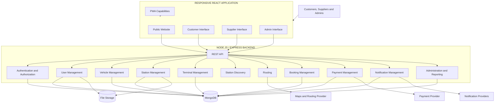
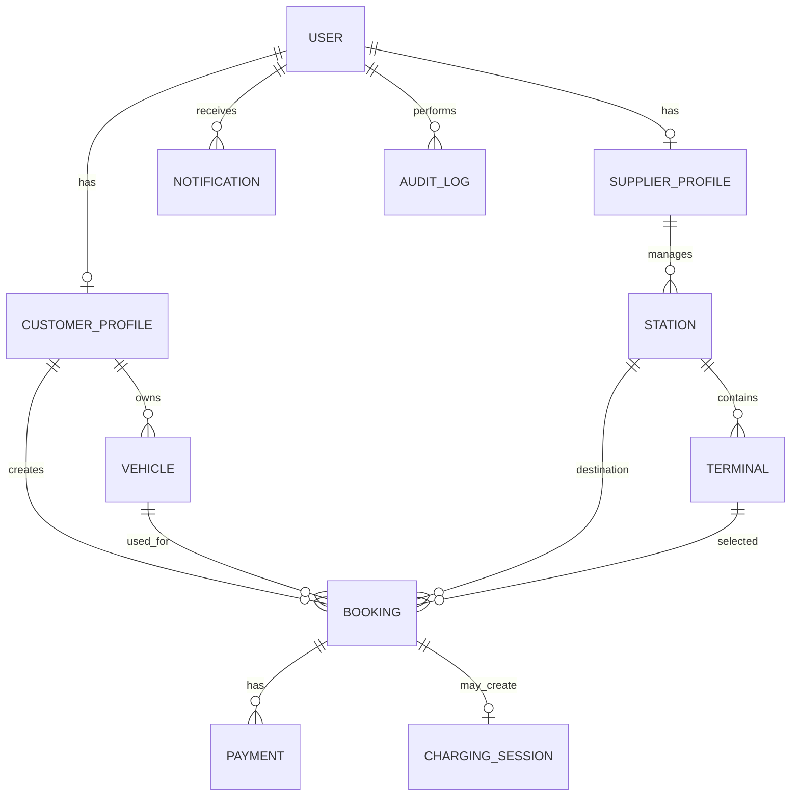

# EXECUTIVE SUMMARY
# EV Charging Platform
### Complete Project Overview, Product Vision, Requirements, System Design, and Implementation Direction

**Document Type:** Master Project Overview and Executive Summary  
**Project:** EV Charging Platform  
**Target Market:** Pakistan  
**Product Category:** Electric Vehicle Charging Infrastructure, Discovery, Booking, and Management Platform  
**Application Type:** Responsive Web Application with Progressive Web App (PWA) capabilities  
**Architecture:** Modular Monolith  
**Technology Foundation:** MERN Stack  
**Primary User Roles:** Customer, Supplier, Super Admin

---

# 1. Introduction

The EV Charging Platform is a technology-based platform designed to connect electric vehicle owners with charging infrastructure providers through a centralized digital system.

Its primary purpose is to make electric vehicle charging easier to discover, access, book, and manage.

The platform provides a common environment in which customers can discover charging stations, inspect their locations, explore available charging terminals, evaluate routes, and request charging bookings. Suppliers can register their charging infrastructure, manage multiple stations and their associated terminals, receive booking requests, respond to customers, and monitor their operational and financial activity.

A Super Admin oversees the platform, manages accounts and infrastructure records, monitors bookings and payments, and maintains the overall operational integrity of the system.

The product is intended to address a practical challenge associated with electric vehicle adoption: access to charging infrastructure is only useful when customers can discover where it is, understand whether it is available, determine whether it suits their vehicle, and coordinate access with the provider.

The platform brings these activities into one organized digital experience.

It is not simply a map displaying charging locations. Its intended functionality extends from infrastructure discovery to booking coordination, payment processing, and supplier-side management.

The system will initially be developed as a single responsive application using the MERN technology foundation, with separate interfaces for customers, suppliers, and administrators.

The architecture will be organized as a modular monolith, allowing the platform to remain maintainable during initial development while retaining clear boundaries for future expansion.

The long-term direction is to establish a dependable digital ecosystem for EV charging services in Pakistan, with the ability to expand its infrastructure coverage, service capabilities, and integrations as the market develops.

---

# 2. Project Vision

## 2.1 Vision Statement

To build an accessible, reliable, and technology-driven EV charging ecosystem that connects electric vehicle owners with charging infrastructure providers, simplifies charging discovery and booking, and helps charging suppliers manage their operations through one unified platform.

## 2.2 Long-Term Vision

The long-term vision extends beyond helping users locate charging stations.

The platform should gradually become a centralized service layer connecting:

- Electric vehicle owners.
- Charging infrastructure suppliers.
- Charging stations.
- Individual charging terminals.
- Location and routing services.
- Booking and reservation workflows.
- Payment services.
- Charging session information.
- Infrastructure availability.
- Operational and supplier analytics.

As the EV ecosystem develops, the platform may also support additional capabilities such as vehicle range estimation, compatibility-based station recommendations, advanced route planning, hardware connectivity, and battery-related services.

These extensions should build upon the same underlying infrastructure rather than requiring an entirely separate product.

## 2.3 Mission

The mission is to reduce the operational and discovery difficulties associated with EV charging by providing:

1. A centralized way to discover charging stations.
2. Transparent access to relevant station and terminal information.
3. Location-aware station discovery and route assistance.
4. A structured booking process between customers and suppliers.
5. An organized environment for suppliers to manage their charging infrastructure.
6. Reliable payment and booking records.
7. Administrative visibility and oversight of platform operations.

---

# 3. The Problem Being Addressed

Electric vehicle ownership requires access to suitable charging infrastructure.

Unlike conventional fuel stations, charging infrastructure may be distributed across different locations, managed by different providers, and equipped with different terminal specifications and availability conditions.

A customer may need to answer several questions before deciding where to charge:

- Where is the nearest suitable charging station?
- How far is it from the customer's current location?
- How long will it take to reach?
- Is the station operational?
- Are charging terminals available?
- Does the terminal support the customer's vehicle?
- What charging options and pricing are offered?
- Can the customer reserve or request access?
- What happens after the booking request is submitted?
- How can payment be completed?

Without a centralized platform, these questions may require visiting multiple information sources or directly contacting different providers.

Suppliers face a different set of challenges.

They need to maintain information about their charging infrastructure, manage multiple physical locations, monitor individual terminals, respond to incoming requests, and keep relevant operational and financial information organized.

The platform is designed to bring both sides together.

## 3.1 Customer-Side Problems

Potential customer difficulties include:

**Fragmented discovery**

Charging station information may not be available in one centralized location.

**Unclear availability**

Knowing that a station exists does not necessarily mean that a suitable terminal is currently available.

**Location uncertainty**

Customers need to understand station locations, distances, and suitable routes.

**Vehicle compatibility**

Different vehicles may support different charging specifications. Customers need sufficient information to identify compatible infrastructure.

**Unstructured booking**

Customers may have to contact suppliers individually or rely on informal communication to coordinate charging access.

**Limited booking visibility**

Customers need to know whether a booking request has been submitted, accepted, rejected, or completed.

## 3.2 Supplier-Side Problems

Potential supplier difficulties include:

**Infrastructure management**

Suppliers may manage multiple stations and several terminals at each station.

**Availability management**

Individual terminals may have different operational states.

**Booking coordination**

Suppliers need a centralized place to receive and respond to customer requests.

**Operational visibility**

Suppliers need to understand their registered infrastructure and relevant activity.

**Financial tracking**

Suppliers need access to relevant booking and payment records.

## 3.3 Platform-Level Problem

Customers and suppliers participate in the same charging ecosystem but have different responsibilities and information needs.

The platform acts as a common coordination layer.

It provides customers with discovery and booking capabilities while offering suppliers the tools to manage their infrastructure and respond to demand.

---

# 4. The Proposed Solution

The proposed solution is a centralized EV charging discovery and management platform.

It provides different interfaces for different user roles while maintaining a shared system and database.

## 4.1 Customer Solution

Customers can:

- Create an account.
- Register their electric vehicles.
- Search for charging stations.
- Search by location.
- Inspect station information.
- View associated charging terminals.
- Check available charging options.
- View route information.
- Request a booking.
- Track booking status.
- Complete the supported payment process.
- View booking and payment history.
- Manage their vehicles and profile.

## 4.2 Supplier Solution

Suppliers can:

- Register a supplier account.
- Complete relevant supplier information.
- Register multiple charging stations.
- Manage station information.
- Add multiple terminals under each station.
- Manage terminal information.
- Maintain supported availability information.
- Receive booking requests.
- Inspect booking details.
- Accept or reject requests.
- Monitor relevant booking activity.
- Review earnings and payment information.
- Manage their supplier profile.

## 4.3 Super Admin Solution

Super Admins can:

- View platform-level information.
- Manage customer accounts.
- Manage supplier accounts.
- Review supplier information and verification requirements.
- View charging stations.
- View charging terminals.
- Monitor booking activity.
- Inspect payment records.
- Review reports.
- Manage relevant platform configurations.
- Inspect administrative audit records.

The actual set of administrative permissions should be defined through the authorization model.

## 4.4 The Central Value Proposition

The platform connects three activities:

**Discovery:** Helping customers find suitable charging infrastructure.

**Coordination:** Connecting customers and suppliers through structured booking requests.

**Management:** Giving suppliers and administrators the tools to oversee charging infrastructure and platform activity.

---

# 5. Target Market and Product Context

## 5.1 Initial Market

The initial target market is Pakistan.

The product should be designed with the practical conditions of the Pakistani EV ecosystem in mind.

Relevant considerations include:

- Uneven geographical distribution of charging infrastructure.
- Different levels of EV adoption across cities.
- Infrastructure managed by different suppliers.
- Differences in charging equipment and compatibility.
- Availability of digital payment methods.
- Variations in internet connectivity.
- The importance of accurate station locations.
- The need for a mobile-friendly experience.

The platform should not assume that every station has automated hardware connectivity or that every supplier has the same operational capabilities.

The product should support a practical initial operating model and allow more advanced infrastructure integration later.

## 5.2 Potential User Segments

### Customers

Potential customer groups include:

- Individual EV owners.
- Electric car owners.
- Electric bike and scooter owners where compatible infrastructure is available.
- EV fleet operators, if fleet functionality is introduced later.
- Other users who need charging access.

### Suppliers

Potential suppliers include:

- Independent charging station operators.
- Businesses operating charging locations.
- Commercial property operators offering EV charging.
- EV infrastructure companies.
- Organizations managing multiple charging locations.

These are potential customer and supplier segments, not confirmed partnerships.

## 5.3 Local Market Requirements

The application should be prepared to support:

- Pakistan-specific location information.
- Appropriate currency presentation, likely PKR.
- Local payment provider integrations.
- Relevant regional map coverage.
- Suitable date and time handling.
- Local contact information.
- Mobile-first access.

Currency, payment methods, local integrations, and other country-specific details must be finalized before production deployment.

---

# 6. Product Structure

The platform consists of five primary interface areas.

1. Public Website.
2. Authentication.
3. Customer Application.
4. Supplier Application.
5. Super Admin Application.

All interfaces belong to the same responsive web application.

They share the same design system, frontend architecture, authentication infrastructure, backend, and database.

However, customer, supplier, and admin users have different navigation and functional permissions.

## 6.1 Public Website

The public website introduces the platform to visitors.

Its purposes include:

- Explaining the platform.
- Communicating its value.
- Introducing the charging discovery service.
- Explaining how customers use it.
- Introducing supplier participation.
- Providing registration and login entry points.
- Providing support and contact information.

### Proposed Public Pages

- Home.
- How It Works.
- Charging Network or Explore Stations.
- For Suppliers.
- Contact or Support.
- Login.
- Registration.
- Privacy Policy.
- Terms and Conditions.

The public website should remain distinct from the authenticated dashboards.

## 6.2 Authentication

Authentication provides account access for customers, suppliers, and administrators.

It should support:

- Registration.
- Login.
- Logout.
- Password recovery.
- Account verification where required.
- Account status handling.
- Role-based navigation.

Customer and supplier registration must follow different workflows where their information requirements differ.

## 6.3 Customer Application

The customer application focuses on:

- Finding charging stations.
- Evaluating location and route information.
- Inspecting terminal availability.
- Requesting charging bookings.
- Managing vehicles.
- Tracking bookings.
- Viewing payments.

## 6.4 Supplier Application

The supplier application focuses on:

- Managing charging infrastructure.
- Registering stations.
- Managing terminals.
- Responding to customer booking requests.
- Maintaining relevant availability information.
- Monitoring operational and financial activity.

## 6.5 Super Admin Application

The Super Admin application focuses on:

- Platform oversight.
- User management.
- Supplier management.
- Infrastructure management.
- Booking and payment monitoring.
- Reporting.
- Administrative security and accountability.

---

# 7. User Roles and Responsibilities

The system has three primary roles.

## 7.1 Customer / Receiver

The Customer, also referred to as the Receiver in the project context, is the user who needs access to charging infrastructure.

### Main Responsibilities

- Maintain an account.
- Register vehicles.
- Discover suitable stations.
- Select a station and terminal.
- Evaluate location and route information.
- Request charging bookings.
- Complete required payment.
- Monitor booking status.
- Review transaction history.

### Customer Permissions

A customer should be able to access their own account information, vehicles, bookings, payments, and relevant public charging station information.

A customer must not be able to:

- Modify another customer's vehicle.
- Manage supplier-owned charging stations.
- Modify terminal operational states.
- Access supplier earnings.
- Perform administrative operations.

## 7.2 Supplier / Provider

The Supplier, also referred to as the Provider, manages charging infrastructure.

### Main Responsibilities

- Maintain a supplier account.
- Register stations.
- Manage station records.
- Register terminals.
- Manage terminal information.
- Handle booking requests.
- Accept or reject requests.
- Monitor operational activity.
- Review earnings and relevant payment records.

### Supplier Permissions

A supplier must be able to manage only infrastructure associated with their authorized account.

A supplier must not be able to:

- Modify another supplier's stations.
- Access unrelated customer accounts.
- Change platform-wide administrative configurations.
- Modify payment records outside authorized operations.
- Access another supplier's terminal records.

## 7.3 Super Admin

The Super Admin is responsible for platform-wide oversight.

### Main Responsibilities

- Manage user accounts.
- Manage supplier accounts.
- Review relevant verification information.
- Monitor registered stations.
- Monitor terminal records.
- Inspect booking activity.
- Inspect payment activity.
- Review relevant operational reports.
- Perform authorized administrative operations.

Administrative functionality must be protected by backend authorization.

A user must not become an administrator merely by changing frontend navigation or sending a modified request.

---

# 8. Core Business Model and Infrastructure Hierarchy

One of the most important concepts in the entire platform is the relationship between suppliers, stations, and charging terminals.

The system must model these entities separately.

## 8.1 Infrastructure Hierarchy

The ownership structure is:

**Supplier → Station → Charging Terminals**

A supplier may manage multiple stations.

Each station may contain multiple charging terminals.

A charging terminal belongs to one specific station.

Example:

```text
Supplier A
│
├── Station 01
│   ├── Terminal 01
│   ├── Terminal 02
│   └── Terminal 03
│
├── Station 02
│   ├── Terminal 01
│   ├── Terminal 02
│   └── Terminal 03
│
└── Station 03
    ├── Terminal 01
    └── Terminal 02
```

Another supplier may independently manage a different set of stations and terminals.

## 8.2 Supplier

Represents the organization or account responsible for charging infrastructure.

The supplier is associated with its registered stations.

## 8.3 Station

Represents a physical charging location.

A station may contain multiple individual charging terminals.

Station information may include:

- Station name.
- Address.
- Geographic coordinates.
- Description.
- Operating information.
- Relevant pricing information.
- Associated terminals.
- Public availability information.

The exact fields will be finalized in the requirements and database design.

## 8.4 Terminal

Represents an individual charging unit or charging point within a station.

Terminal information may include:

- Terminal identifier.
- Parent station.
- Charging specifications.
- Connector information.
- Supported power information.
- Operational state.
- Availability state.
- Relevant pricing or charging information.

A station may be discoverable even if some of its terminals are unavailable.

Therefore, station status and individual terminal status must remain distinguishable.

## 8.5 Customer Vehicle

Represents an electric vehicle associated with a customer.

Vehicle information may include:

- Manufacturer.
- Model.
- Vehicle category.
- Relevant battery specifications.
- Charging connector compatibility.
- Supported charging capabilities.

Vehicle specifications will help the platform provide better charging recommendations when compatible infrastructure information is available.

---

# 9. Customer Journey: Complete Workflow

The customer journey begins with account creation and ends with charging service completion and transaction history.

## 9.1 Registration

The customer opens the public website and selects registration.

The platform offers a customer registration path.

The customer provides the required account information.

The backend validates the information and creates the account.

Any required account verification is completed.

The customer enters the Customer Application.

## 9.2 Vehicle Registration

The customer registers one or more vehicles.

The platform stores their relationship with the customer account.

Relevant vehicle information can later be used to filter charging terminals based on supported specifications.

## 9.3 Station Discovery

The customer opens Find Charging Stations.

The customer can:

- Use their current location, if permission is granted.
- Enter a location manually.
- Search for stations.
- Inspect station results.
- View station locations on a map.
- View relevant station information.

The discovery module retrieves appropriate station records from the backend.

## 9.4 Route Evaluation

The customer selects a station or evaluates potential charging destinations.

The platform retrieves or calculates relevant route information.

Possible information includes:

- Starting location.
- Destination.
- Route distance.
- Estimated travel time.
- Route geometry.
- Alternative routes, if supported.

The platform should distinguish between straight-line geographic distance and actual road-route distance.

## 9.5 Terminal Selection

The customer opens the selected station.

The platform displays its associated terminals and relevant information.

The customer selects a suitable terminal based on supported charging specifications and availability.

The system must verify the relationship between the selected terminal and the selected station.

## 9.6 Booking Request

The customer submits a booking request.

The backend validates:

- Authenticated customer identity.
- Vehicle ownership where applicable.
- Station existence.
- Terminal existence.
- Station-terminal relationship.
- Relevant charging compatibility.
- Booking information.
- Terminal availability.
- Booking rules.

A valid request is recorded as pending supplier response.

## 9.7 Supplier Response

The corresponding supplier receives the booking request.

The supplier inspects the request and chooses to accept or reject it.

The backend validates the supplier's ownership and the current booking state.

The customer is informed of the result.

## 9.8 Payment

When the supplier accepts the booking, the payment workflow proceeds according to the finalized payment policy.

The customer is presented with the required payment information.

The payment module communicates with the selected payment provider.

The backend verifies the transaction outcome.

The booking and payment records are updated according to the confirmed result.

## 9.9 Charging and Completion

Once the booking is confirmed, the customer can access the charging service according to the platform's operational rules.

Actual charging session functionality depends on the supplier's infrastructure and available verification mechanism.

Where supported, the platform may record:

- Charging session start.
- Charging session end.
- Charging duration.
- Energy delivered.
- Relevant terminal.
- Session completion state.

If hardware integration is unavailable, the system must not pretend to have verified physical charging measurements.

## 9.10 Booking History

The customer can inspect previous and current bookings.

Each record should present its status and relevant transaction information.

Payment status must be shown separately from booking status.

---

# 10. Supplier Journey: Complete Workflow

The supplier journey starts with registration and infrastructure setup.

It continues through station management, terminal registration, booking coordination, and earnings visibility.

## 10.1 Supplier Registration

The user selects Supplier Registration.

The platform collects the relevant account and business information.

The backend creates the supplier account and profile.

Any required verification or approval process is handled according to the finalized supplier policy.

## 10.2 Supplier Dashboard

The supplier enters the Supplier Application.

The overview provides relevant information such as:

- Registered stations.
- Registered terminals.
- Available terminals.
- Unavailable terminals.
- Pending booking requests.
- Recent activity.
- Earnings information.

The dashboard should prioritize operational work.

## 10.3 Station Registration

The supplier creates a station record.

The supplier provides relevant information, such as:

- Station name.
- Location.
- Address.
- Geographic coordinates.
- Operating information.
- Relevant station details.

The backend associates the new station with the authenticated supplier.

## 10.4 Terminal Registration

The supplier selects a station and registers its charging terminals.

Every terminal must have an identifiable parent station.

The system validates that the supplier is authorized to manage that station.

A supplier can repeat this process to register multiple terminals and additional stations.

## 10.5 Terminal Management

Suppliers can inspect and update their terminals.

Possible operations:

- View terminal details.
- Update terminal information.
- Change supported operational state.
- Manage availability.
- Place a terminal into maintenance or unavailable status where appropriate.

The platform must distinguish between the physical operational state and whether a terminal can accept a booking.

## 10.6 Booking Request Management

The supplier receives incoming booking requests.

A request contains the relevant information needed for a decision.

Potential information includes:

- Booking reference.
- Customer information permitted by policy.
- Vehicle details permitted by policy.
- Station.
- Terminal.
- Requested booking details.
- Current status.

The supplier can accept or reject the request.

## 10.7 Earnings and Payments

The supplier can inspect relevant financial records.

Possible information:

- Completed bookings.
- Gross booking amounts.
- Platform fees, if applicable.
- Supplier payable amount.
- Payment status.
- Settlement information.

The exact fee, commission, and settlement model must be defined before financial implementation.

---

# 11. Super Admin Journey

The Super Admin oversees the entire platform.

The admin interface must provide visibility into the different parts of the business without mixing administrative responsibilities with normal customer or supplier workflows.

## 11.1 Account Management

Admin can inspect customer and supplier records.

Authorized actions may include:

- Viewing accounts.
- Updating permitted account information.
- Suspending accounts.
- Reviewing supplier verification.
- Managing account status.

## 11.2 Infrastructure Oversight

Admin can view registered stations and terminals.

The platform should provide visibility into:

- Station ownership.
- Parent supplier.
- Station location.
- Associated terminals.
- Operational information.
- Relevant availability.

## 11.3 Booking Oversight

Admin can inspect booking records.

Possible information:

- Customer.
- Supplier.
- Station.
- Terminal.
- Booking status.
- Booking dates.
- Relevant operational history.

## 11.4 Payment Oversight

Admin can inspect transaction records.

Sensitive financial actions must require explicit permissions and must be recorded appropriately.

## 11.5 Reports and Audit

The admin can view relevant platform reports and audit records.

Administrative actions must be traceable.

---

# 12. Location Discovery and Mapping System

Location-based discovery is one of the platform's defining capabilities.

The mapping system must be designed as a functional part of the platform rather than a decorative map embedded in the page.

## 12.1 Purpose

The location system allows customers to identify charging stations and understand how to reach them.

## 12.2 Location Inputs

Possible starting locations:

- Current device location.
- Manually entered address.
- Selected map location.

Current location requires appropriate user permission.

Manual location selection must remain possible when permission is unavailable or denied.

## 12.3 Station Coordinates

Each discoverable station must have suitable geographical coordinates.

Station coordinates support:

- Map markers.
- Nearby station queries.
- Geographic searches.
- Route destinations.
- Distance calculation.

Address text alone is not sufficient for accurate geographic routing.

## 12.4 Station Map

The map should display relevant charging station markers.

Marker states may distinguish:

- Available charging infrastructure.
- Unavailable infrastructure.
- Selected station.
- User location.
- Destination.

The station list and map must remain synchronized.

Selecting a station from the list should highlight the corresponding marker.

Selecting a marker should identify the matching station information.

## 12.5 Routing

The routing module should determine routes using appropriate map or road-network data.

Possible route information:

- Distance.
- Estimated time.
- Route geometry.
- Route alternatives.

The platform should not assume that the nearest station geographically is necessarily the fastest or most suitable station by road.

## 12.6 Dijkstra's Algorithm

Dijkstra's algorithm is relevant to the project's shortest-path requirement.

It operates on a weighted graph:

- Vertices represent locations or road-network nodes.
- Edges represent connections.
- Weights represent distance, travel cost, time, or another measurable quantity.

It finds a minimum-cost path where edge weights are non-negative.

However, it requires an appropriate graph.

A list of station coordinates is not, by itself, a road network.

To calculate real road routes, the platform requires road-network graph data or a routing provider.

The architecture therefore separates:

1. Geographic location data.
2. Road-network or routing data.
3. Route calculation.
4. Map visualization.
5. Charging station discovery.

The specific routing implementation remains an engineering decision.

---

# 13. Booking System and Operational Rules

Booking is the central coordination mechanism between customers and suppliers.

## 13.1 Booking Purpose

A booking records a customer's request to use a particular charging terminal under the platform's agreed conditions.

It connects:

- Customer.
- Vehicle, where applicable.
- Supplier.
- Station.
- Terminal.
- Booking details.
- Payment information.
- Operational status.

## 13.2 Booking States

The initial conceptual lifecycle is:

| Status | Explanation |
|---|---|
| PENDING_SUPPLIER | Request has been submitted and awaits supplier response |
| REJECTED | Supplier rejected the request |
| ACCEPTED_AWAITING_PAYMENT | Supplier accepted, but required payment is not confirmed |
| CONFIRMED | Required booking confirmation conditions have been met |
| IN_PROGRESS | Charging activity has started, where tracked |
| COMPLETED | The relevant charging service or booking has been completed |
| CANCELLED | The booking has been cancelled under permitted rules |
| EXPIRED | The booking expired without reaching the required next state |

The final state machine, cancellation rules, and expiry policy must be defined before production implementation.

## 13.3 Booking Validation

The backend must verify that:

- The customer is authenticated.
- The station exists.
- The terminal exists.
- The terminal belongs to the selected station.
- The supplier manages that station.
- The booking request satisfies the configured requirements.
- The terminal is eligible for booking.
- The selected terminal is compatible with the vehicle where compatibility data is available.

## 13.4 Concurrent Booking Prevention

Two customers may attempt to book the same terminal around the same time.

The system must perform availability validation and the relevant state update through an appropriate atomic or transaction-safe operation.

A frontend availability indicator cannot guarantee that a booking is available when the request reaches the backend.

If time-slot reservations are implemented, overlapping requests must be prevented.

The booking data model must define the booking interval and its relationship to terminal availability.

## 13.5 Booking Versus Charging Session

A booking and a charging session are distinct.

A booking represents reservation or coordination.

A charging session represents actual charging activity.

The system should not claim that charging has started simply because a booking was confirmed.

Actual session records require a defined method of verification, which may initially be supplier-managed or hardware-integrated in a later phase.

---

# 14. Payment and Financial Model

Payment is a separate business capability connected to booking management.

## 14.1 Payment Workflow

The proposed sequence is:

1. Customer submits booking request.
2. Supplier reviews request.
3. Supplier accepts the request.
4. Payment requirement is presented according to the booking policy.
5. Customer completes the supported payment process.
6. Backend verifies payment outcome.
7. Transaction record is updated.
8. Booking workflow proceeds according to the verified result.
9. Relevant users receive updates.

This sequence is a proposed baseline. Whether payment is required before confirmation, captured at booking time, or handled through another arrangement must be finalized.

## 14.2 Payment States

Potential states:

- PENDING.
- PROCESSING.
- SUCCEEDED.
- FAILED.
- CANCELLED.
- REFUNDED.
- PARTIALLY_REFUNDED, if supported.

## 14.3 Payment Verification

A payment must be confirmed through the backend and relevant payment provider.

A browser redirect or customer-side success message is not sufficient evidence of a successful payment.

Payment webhooks must be authenticated and processed safely.

Duplicate payment requests and repeated provider callbacks must not generate duplicate financial records.

## 14.4 Supplier Earnings

Supplier earnings should be derived from verified financial records.

Potential elements:

- Customer payment amount.
- Platform fee or commission, if applicable.
- Supplier payable amount.
- Refunds or adjustments.
- Settlement status.

The platform's commission model, payment gateway, settlement frequency, and refund policy remain decisions to finalize.

## 14.5 Currency and Local Payments

The target market is Pakistan.

The platform should be designed with appropriate currency handling and support for the payment methods selected for local operation.

PKR is the likely primary currency, but payment provider selection and financial configuration must be confirmed.

The system should avoid hardcoding monetary assumptions throughout the codebase.

---

# 15. Notification System

Notifications inform users about important platform events.

## 15.1 Customer Notifications

Potential events:

- Booking submitted.
- Booking accepted.
- Booking rejected.
- Booking status changed.
- Payment successful.
- Payment failed.
- Booking cancelled.
- Other relevant account updates.

## 15.2 Supplier Notifications

Potential events:

- New booking request.
- Customer booking cancellation.
- Relevant payment update.
- Operational issue.
- Account or verification update.

## 15.3 Admin Notifications

Potential events:

- Supplier verification request.
- Important account issue.
- Operational alert.
- Relevant payment or infrastructure event.

## 15.4 Delivery Channels

The architecture may support:

- In-app notifications.
- Email.
- SMS.
- Web Push notifications.
- Real-time updates.

These channels have different requirements and will be implemented according to the chosen providers and user preferences.

In-app notifications should remain available even when browser push notifications are not supported or have been denied.

## 15.5 Real-Time Communication

Real-time communication may be implemented using WebSockets or an appropriate event-delivery technology.

It can help deliver new booking requests and status updates quickly.

However, a real-time message is not the authoritative record.

The backend database remains the source of truth.

The frontend should retrieve the current booking or payment state from the backend when needed.

---

# 16. Product Requirements and Functional Scope

This section consolidates the principal functional capabilities.

## 16.1 Authentication and Accounts

The platform should support:

- Customer account registration.
- Supplier account registration.
- Login and logout.
- Secure password storage.
- Password recovery.
- Account verification where required.
- Role-based access.
- Account status handling.
- Profile management.

## 16.2 Customer Requirements

- Register customer profile.
- Register multiple vehicles.
- Update vehicle information.
- Discover charging stations.
- Search by location.
- View station details.
- View terminal details.
- Inspect availability.
- Inspect supported charging information.
- View route information.
- Submit booking requests.
- View supplier decisions.
- Complete relevant payments.
- View booking history.
- View transaction history.
- Receive notifications.

## 16.3 Supplier Requirements

- Register supplier profile.
- Complete verification requirements where applicable.
- Register multiple stations.
- Edit station details.
- Manage station records.
- Register multiple terminals per station.
- Edit terminal details.
- Manage relevant operational states.
- View booking requests.
- Accept booking requests.
- Reject booking requests.
- View booking history.
- View relevant financial information.
- Receive notifications.

## 16.4 Administrative Requirements

- Inspect users.
- Manage permitted customer records.
- Manage permitted supplier records.
- Review verification where applicable.
- Inspect stations.
- Inspect terminals.
- Inspect bookings.
- Inspect payments.
- View reports.
- Access audit records.
- Manage supported platform settings.

## 16.5 System Requirements

- Centralized database.
- Backend-enforced authorization.
- Resource ownership verification.
- API validation.
- Consistent state transitions.
- Error handling.
- Logging.
- Secure configuration.
- Responsive user interfaces.
- PWA capabilities.
- Backup and deployment strategy.

---

# 17. Technology Stack

The confirmed technology direction is based on the MERN stack.

MERN consists of:

- MongoDB.
- Express.js.
- React.
- Node.js.

The following architecture describes how these technologies fit into the platform.

## 17.1 MongoDB

MongoDB will be the primary database.

It will store:

- User records.
- Customer profiles.
- Supplier profiles.
- Vehicles.
- Stations.
- Charging terminals.
- Bookings.
- Payments.
- Charging sessions, where tracked.
- Notifications.
- Audit records.

The database model must preserve the supplier, station, and terminal hierarchy.

It must also support appropriate references, validation, indexes, and transactional operations.

## 17.2 Express.js

Express.js provides the backend API layer.

It handles:

- HTTP requests.
- Routing.
- Middleware.
- Authentication integration.
- Authorization.
- Request validation.
- Error handling.
- API response formatting.

Business logic should remain in the relevant application modules rather than being placed entirely inside Express controllers.

## 17.3 React

React provides the responsive frontend.

It supports:

- Public website.
- Customer dashboard.
- Supplier dashboard.
- Admin dashboard.
- Authentication.
- Maps.
- Booking workflows.
- Reusable UI components.
- Responsive interface behavior.

The application must use the established design system and role-specific layouts.

## 17.4 Node.js

Node.js runs the backend application and relevant background processing.

It supports:

- API execution.
- Business modules.
- Database communication.
- External integrations.
- Notification processing.
- Background jobs where needed.

## 17.5 Additional Technology Decisions

Other technologies may be considered as supporting tools.

Potential selections discussed include:

| Area | Possible direction | Status |
|---|---|---|
| Frontend language | TypeScript | To finalize |
| React framework | Next.js or another React setup | To finalize |
| Styling | Tailwind CSS | Candidate |
| UI components | shadcn/ui | Candidate |
| MongoDB object modeling | Mongoose | Candidate |
| Maps | Leaflet or another provider | To finalize |
| Routing | Routing provider and/or internal algorithm | To finalize |
| Authentication | Secure session or token-based strategy | To finalize |
| File storage | Cloudinary or suitable object storage | To finalize |
| Real-time communication | WebSockets or Socket.IO | To finalize |
| Frontend hosting | Vercel or suitable hosting | To finalize |
| Backend hosting | Suitable Node.js hosting | To finalize |
| Notifications | Email, SMS, and Web Push providers | To finalize |
| Payment | Suitable Pakistani payment provider | To finalize |

These supporting tools should not be described as already implemented or permanently selected.

The final technology decisions should be recorded in `TECHSTACK.md`.

---

# 18. System Architecture

## 18.1 Recommended Architectural Style

The platform should initially use a **Modular Monolith**.

A modular monolith is one deployable backend application divided into well-defined business modules.

This approach provides modularity without the operational complexity of multiple microservices.

## 18.2 Why Modular Monolith?

The initial platform is being developed as a product with several connected workflows.

A microservices architecture would introduce additional requirements such as:

- Independent service deployment.
- Service-to-service communication.
- Distributed authentication.
- More complicated monitoring.
- Distributed transaction handling.
- Additional infrastructure.
- More difficult debugging.

These costs are unnecessary at the initial development stage.

A modular monolith allows the team to maintain clear business boundaries while developing and deploying the backend as one coordinated application.

If the platform grows significantly, selected modules can be extracted into independent services.

## 18.3 System Layers

The system contains five logical layers:

1. Client Layer.
2. API Layer.
3. Application and Business Logic Layer.
4. Data Layer.
5. External Integration Layer.

### Client Layer

Contains the responsive React application and PWA capabilities.

### API Layer

Receives requests, validates them, and directs them to the appropriate business modules.

### Business Logic Layer

Handles authentication, bookings, stations, terminals, payments, routing, notifications, and administrative operations.

### Data Layer

Stores persistent records in MongoDB and stores files in a suitable storage system.

### External Integration Layer

Communicates with maps, payment providers, notification services, and other external systems.

## 18.4 High-Level Architecture



This diagram illustrates logical responsibilities. It does not indicate that each module is an independently deployed service.

---

# 19. Backend Modules

The backend should have clear business responsibilities.

| Module | Responsibility |
|---|---|
| Authentication | User identity and authentication |
| Authorization | Role and resource permission enforcement |
| User Management | Customer and supplier account records |
| Vehicle Management | Customer-owned vehicles |
| Station Management | Supplier charging locations |
| Terminal Management | Charging terminals and their operational states |
| Station Discovery | Location-based search and station results |
| Routing | Route calculation or provider integration |
| Booking Management | Booking creation and state transitions |
| Charging Session Management | Actual charging activity where recorded |
| Payment Management | Payment records and provider interactions |
| Notification Management | In-app and external notifications |
| Administration | Platform oversight and privileged actions |
| Reporting | Operational and financial reporting |
| Audit | Records of important actions |

Each module must have a defined responsibility and controlled interfaces to other modules.

---

# 20. Database Architecture

MongoDB will store the platform's primary business records.

The exact collection names, fields, and schemas will be defined in `DATABASE_DESIGN.md`.

## 20.1 Core Entities

| Entity | Description |
|---|---|
| User | Shared account and identity information |
| Customer Profile | Customer-specific information |
| Supplier Profile | Supplier-specific information |
| Vehicle | Customer-owned vehicle |
| Station | Physical charging location |
| Terminal | Charging unit belonging to a station |
| Booking | Customer request and reservation record |
| Payment | Transaction record |
| Charging Session | Record of actual charging activity where tracked |
| Notification | User notification |
| Audit Log | Record of important actions |

## 20.2 Primary Relationships



## 20.3 Data Ownership

Every protected record must have a clear ownership rule.

Examples:

- Vehicles belong to customers.
- Stations belong to suppliers.
- Terminals belong to stations.
- Bookings refer to customers and charging infrastructure.
- Payments refer to their relevant booking.
- Notifications belong to recipients.

The backend must enforce these relationships.

## 20.4 Database Integrity

Important operations may involve multiple related records.

The implementation should use suitable database transactions or atomic operations where required.

Examples:

- Creating a booking while reserving availability.
- Processing a payment result and updating related records.
- Changing a terminal's operational state.
- Completing an associated charging session.

The database design must be based on the platform's actual query and update patterns.

---

# 21. API Architecture

The frontend and backend should communicate through documented REST APIs using JSON.

The API should be versioned, beginning with a structure such as:

`/api/v1/`

Conceptual route groups include:

| API Group | Purpose |
|---|---|
| `/auth` | Registration, login, logout, recovery |
| `/customers` | Customer profile |
| `/vehicles` | Vehicle management |
| `/stations` | Public station information |
| `/supplier/stations` | Supplier station management |
| `/supplier/terminals` | Supplier terminal management |
| `/discovery` | Charging station discovery |
| `/routes` | Route requests |
| `/bookings` | Customer booking operations |
| `/supplier/bookings` | Supplier booking operations |
| `/payments` | Payment operations |
| `/notifications` | Notification retrieval and updates |
| `/admin` | Administrative operations |
| `/webhooks` | Verified external provider callbacks |

Endpoints must apply authentication, authorization, ownership checks, validation, and appropriate business rules.

The API should return consistent success and error formats.

Frontend code must never connect directly to MongoDB.

---

# 22. Event-Driven Operations and Background Processing

Some business operations create additional work.

For example:

- Creating a booking should notify the supplier.
- Accepting a booking should inform the customer.
- Payment completion should update the relevant workflow.
- Booking expiration may require releasing reserved availability.
- Terminal status changes may require notifying relevant users.

These operations should be represented as explicit business events.

Potential events include:

- UserRegistered.
- SupplierRegistered.
- StationCreated.
- TerminalRegistered.
- BookingRequested.
- BookingAccepted.
- BookingRejected.
- BookingCancelled.
- PaymentSucceeded.
- PaymentFailed.
- ChargingSessionStarted.
- ChargingSessionCompleted.

Events must be generated after the relevant business operation succeeds.

Time-consuming or retryable operations may be handled by background workers.

Possible background operations:

- Sending email.
- Sending notifications.
- Expiring pending bookings.
- Processing payment callbacks.
- Generating reports.
- Synchronizing external data.

For important workflows, reliable event delivery and retry behavior should be considered.

The system should not depend on temporary in-memory timers for critical scheduled operations.

---

# 23. UI and Design System

The entire platform should maintain one consistent visual identity.

It must look like one connected product even though its user roles have different application layouts.

The visual direction is clean, light, modern, professional, and practical.

It should prioritize usability over decorative effects.

## 23.1 Confirmed Brand Colors

The following colors are confirmed:

| Design Element | HEX |
|---|---|
| Primary Brand | `#0B7D68` |
| Main Page Background | `#E4F0F0` |
| Card and Panel Surface | `#CCCECF` |

Supporting design colors:

| Element | HEX |
|---|---|
| Primary Text | `#18332F` |
| Secondary Text | `#52635F` |
| Muted Text | `#74827F` |
| Border | `#B8C5C2` |
| Success | `#25865B` |
| Warning | `#B7791F` |
| Danger | `#C44D4D` |
| Information | `#3977A3` |

The three confirmed colors form the visual foundation.

The card surface must not automatically be replaced with conventional pure-white cards.

Because the page and card surfaces are relatively close in brightness, subtle borders and controlled shadows should maintain visual separation.

## 23.2 Typography

The recommended primary font is Inter.

Typography should use a consistent hierarchy for:

- Page titles.
- Section titles.
- Card headings.
- Body content.
- Form labels.
- Supporting text.
- Metadata.

## 23.3 Component Design

The platform should have reusable components for:

- Buttons.
- Inputs.
- Select controls.
- Cards.
- Status badges.
- Tables.
- Dialogs.
- Navigation.
- Page headers.
- Search controls.
- Empty states.
- Loading states.
- Error states.

Components should be shared across role-specific interfaces where their functionality is common.

## 23.4 Visual Principles

The design should avoid:

- Predominantly dark interface styling.
- Neon colors and glowing effects.
- Heavy glassmorphism.
- Excessive gradients.
- Excessive corner rounding.
- Generic AI-dashboard styling.
- Unnecessary decorative charts.
- Unrelated metric cards.
- Excessive visual complexity.

The platform's visual quality should come from consistent spacing, readable information hierarchy, thoughtful layouts, and reliable interactions.

---

# 24. Application Layouts and Navigation

## 24.1 Public Navigation

The public website should include:

- Logo.
- Home.
- How It Works.
- Charging Network or Explore.
- For Suppliers.
- Contact or Support.
- Sign In.
- Get Started.

## 24.2 Customer Navigation

Recommended desktop navigation:

1. Overview.
2. Find Charging Stations.
3. My Bookings.
4. My Vehicles.
5. Payments.
6. Notifications.
7. Profile and Settings.

Recommended mobile navigation:

1. Home.
2. Explore.
3. Bookings.
4. Profile.

Other features should remain accessible through appropriate secondary navigation.

## 24.3 Supplier Navigation

Recommended desktop navigation:

1. Overview.
2. Booking Requests.
3. My Stations.
4. Charging Terminals.
5. Earnings and Payments.
6. Reports.
7. Notifications.
8. Profile and Settings.

Recommended mobile navigation:

1. Overview.
2. Bookings.
3. Stations.
4. More.

## 24.4 Admin Navigation

Recommended navigation:

1. Overview.
2. Users.
3. Suppliers.
4. Stations.
5. Charging Terminals.
6. Bookings.
7. Payments.
8. Reports and Analytics.
9. Audit Logs.
10. System Settings.

The actual navigation should reflect implemented functionality and permissions.

---

# 25. Responsive Application and PWA Strategy

The platform will be one responsive application.

It will adapt to:

- Mobile.
- Tablet.
- Desktop.
- Installed PWA mode where supported.

There will not be separate mobile and desktop products.

## 25.1 Responsive Design

The interface will reorganize itself according to viewport width.

Initial breakpoint guidelines:

| Screen Category | Width |
|---|---|
| Small Mobile | Below 480px |
| Mobile | 480–639px |
| Tablet | 640–1023px |
| Desktop | 1024–1279px |
| Wide Desktop | 1280px and above |

Mobile layouts should prioritize essential information and actions.

Desktop layouts may use wider multi-column structures.

Tablet layouts should balance information visibility and navigation.

## 25.2 PWA Capabilities

The PWA layer may provide:

- Installability where supported.
- Standalone application launching.
- Application icon.
- Application name and theme metadata.
- Service worker.
- Controlled static asset caching.
- Selected offline experiences.
- Supported push notifications.

Installation must remain optional.

The browser-accessible version must continue working without requiring installation.

## 25.3 Offline Limitations

The platform depends on live backend information for important operations.

The following should require an active connection:

- Live station availability.
- Booking submission.
- Booking acceptance or rejection.
- Payment processing.
- Updated terminal information.
- Administrative modifications.

Cached information must be identified as potentially outdated.

A booking or payment must never be represented as successful if the backend has not confirmed the operation.

## 25.4 Mobile Usability

Special attention should be given to:

- Charging station discovery.
- Map interaction.
- Booking request submission.
- Supplier booking acceptance.
- Station management.
- Terminal management.
- Responsive forms and tables.

The interface must remain usable with touch input.

---

# 26. Security and Privacy

Security is a foundational requirement because the platform manages accounts, location information, bookings, supplier infrastructure, and financial records.

## 26.1 Authentication Security

The platform should implement:

- Secure password hashing.
- HTTPS.
- Protected sessions or tokens.
- Expiration and renewal handling.
- Secure logout.
- Password recovery.
- Account verification where appropriate.
- Protection against brute-force attempts.

For browser authentication, secure HttpOnly cookies are an option to evaluate. The chosen implementation must account for CSRF protection and appropriate cookie settings.

Long-lived authentication secrets must not be casually stored in browser local storage.

## 26.2 Authorization Security

Initial roles:

- CUSTOMER.
- SUPPLIER.
- SUPER_ADMIN.

Authorization must verify both role and resource ownership.

For example:

- A customer can access their own vehicle records.
- A supplier can manage only their own stations.
- A supplier can manage terminals associated with their stations.
- An admin can access privileged operations according to their permissions.

## 26.3 Input Validation

The backend must validate all incoming data.

This includes:

- Account information.
- Vehicle information.
- Station information.
- Terminal information.
- Booking requests.
- Payment-related requests.
- Uploaded files.
- Administrative operations.

Client-side validation improves usability but does not replace server-side validation.

## 26.4 Payment Security

Payment operations must:

- Use secure provider integration.
- Verify gateway callbacks.
- Prevent duplicate processing.
- Keep accurate transaction records.
- Avoid storing raw card details.
- Protect transaction history.
- Enforce permissions.

## 26.5 File Security

Uploaded files should have appropriate:

- File type restrictions.
- Size restrictions.
- Validation.
- Storage permissions.
- Access controls.

Files must not be placed into public storage without an appropriate access decision.

## 26.6 Logging and Auditing

Record relevant operational and administrative actions.

Logs must not expose:

- Passwords.
- Authentication tokens.
- Payment secrets.
- Unnecessary personal information.

Important administrative changes should be traceable.

## 26.7 Data Protection

The platform should collect only the data necessary for its intended functionality.

Location permissions should be requested when relevant.

Users should understand when their location is used for station discovery.

Access to personal and operational information must follow defined authorization rules.

---

# 27. Reliability, Performance, and Scalability

The platform must be designed to work reliably under normal operating conditions and recover appropriately from failures.

## 27.1 Reliability

Potential failure scenarios include:

- Database connectivity problems.
- Network interruptions.
- Payment provider failures.
- Mapping service failures.
- Notification delivery failures.
- Duplicate requests.
- Concurrent booking attempts.

The platform must provide clear error handling.

Important booking and payment operations must preserve data integrity.

## 27.2 Performance

The application should be efficient on both mobile and desktop connections.

Recommended practices include:

- Optimized images.
- Appropriate code splitting.
- Controlled API requests.
- Pagination.
- Database indexing.
- Geospatial indexes.
- Lazy loading.
- Map marker management.
- Appropriate caching.
- Background processing for longer operations.

## 27.3 Scalability

The initial modular monolith should permit future growth.

Potential growth may require:

- More backend instances.
- Background workers.
- Distributed job queues.
- Optimized database queries.
- Read-heavy query optimization.
- Dedicated routing infrastructure.
- Separate notification processing.
- Independent service extraction.

Microservices should only be introduced when justified by actual operational requirements.

---

# 28. External Integrations

The platform will depend on external services for selected functionality.

The actual providers remain to be finalized.

## 28.1 Mapping Provider

Required capabilities may include:

- Maps.
- Geocoding.
- Location search.
- Routing.
- Route geometry.
- Distance and travel time.

## 28.2 Payment Provider

Required capabilities may include:

- Payment initiation.
- Payment status verification.
- Transaction references.
- Webhooks.
- Refund functionality where supported.

The selection must be appropriate for the target market.

## 28.3 Email Provider

Potential responsibilities:

- Account verification.
- Password recovery.
- Booking updates.
- Important account communication.

## 28.4 SMS Provider

Potential responsibilities:

- OTP delivery where supported.
- Important booking updates.
- Other relevant transactional notifications.

## 28.5 Push Notifications

Web Push may deliver notifications to supported browser and installed PWA environments.

## 28.6 File Storage

A dedicated file or media storage service may handle supplier images, station images, verification documents, and other supported uploads.

## 28.7 Charging Hardware Integration

Future hardware integrations may provide:

- Terminal status.
- Charging session status.
- Energy measurements.
- Operational telemetry.
- Automated availability updates.

This functionality depends on actual hardware capabilities, device protocols, connectivity, and supplier agreements.

It is not assumed to be available in the initial implementation.

---

# 29. Non-Functional Requirements

In addition to features, the platform must meet broader engineering requirements.

## 29.1 Usability

The application must be understandable to users who are not technically experienced.

Navigation and actions should be predictable.

## 29.2 Accessibility

Provide:

- Readable text.
- Appropriate contrast.
- Visible focus states.
- Accessible controls.
- Clear form labels.
- Meaningful status labels.
- Touch-friendly interaction.

## 29.3 Maintainability

Maintain a clear codebase with:

- Modular business logic.
- Reusable components.
- Consistent conventions.
- Documented API behavior.
- Centralized design tokens.
- Clear ownership boundaries.

## 29.4 Reliability

Important operations must have predictable outcomes and appropriate error handling.

## 29.5 Security

Protected information and operations must be subject to authentication, authorization, validation, and safe data handling.

## 29.6 Responsiveness

Every major interface must work across mobile, tablet, and desktop.

## 29.7 Compatibility

The application should be tested on relevant modern browsers and devices.

## 29.8 Observability

The platform should provide appropriate application logs, error monitoring, operational visibility, and audit records.

## 29.9 Data Integrity

Relationships, booking states, payment states, and financial records must remain consistent.

## 29.10 Extensibility

Additional features and external integrations should be introduced without requiring unnecessary changes to unrelated modules.

---

# 30. Proposed Project Structure

The exact directory structure should follow the selected framework and existing implementation.

The following is a conceptual organization.

```text
EV-Charging-Platform/
│
├── client/
│   │
│   ├── public/
│   │
│   ├── src/
│   │   ├── app-or-routes/
│   │   │   ├── public/
│   │   │   ├── customer/
│   │   │   ├── supplier/
│   │   │   └── admin/
│   │   │
│   │   ├── components/
│   │   │   ├── ui/
│   │   │   ├── shared/
│   │   │   └── layout/
│   │   │
│   │   ├── features/
│   │   │   ├── authentication/
│   │   │   ├── customers/
│   │   │   ├── suppliers/
│   │   │   ├── vehicles/
│   │   │   ├── stations/
│   │   │   ├── terminals/
│   │   │   ├── discovery/
│   │   │   ├── bookings/
│   │   │   ├── payments/
│   │   │   └── administration/
│   │   │
│   │   ├── services/
│   │   ├── hooks/
│   │   ├── styles/
│   │   └── assets/
│   │
│   └── package.json
│
├── server/
│   │
│   ├── src/
│   │   ├── config/
│   │   ├── middleware/
│   │   ├── modules/
│   │   │   ├── authentication/
│   │   │   ├── users/
│   │   │   ├── vehicles/
│   │   │   ├── stations/
│   │   │   ├── terminals/
│   │   │   ├── discovery/
│   │   │   ├── routing/
│   │   │   ├── bookings/
│   │   │   ├── charging-sessions/
│   │   │   ├── payments/
│   │   │   ├── notifications/
│   │   │   ├── administration/
│   │   │   ├── reporting/
│   │   │   └── audit/
│   │   │
│   │   ├── integrations/
│   │   ├── jobs/
│   │   ├── shared/
│   │   ├── utils/
│   │   └── app/
│   │
│   └── package.json
│
├── docs/
│   │
│   ├── UI/
│   │   ├── 01_VISUAL_DIRECTION.md
│   │   ├── 02_DESIGN_SYSTEM_AND_APPLICATION_LAYOUTS.md
│   │   ├── 03_RESPONSIVE_DESIGN_AND_PWA.md
│   │   └── 04_PAGE_CREATION_AND_UI_CONSISTENCY_STANDARD.md
│   │
│   ├── PROJECT_REQUIREMENTS.md
│   ├── TECHSTACK.md
│   ├── USER_FLOWS.md
│   ├── SYSTEM_ARCHITECTURE.md
│   ├── DATABASE_DESIGN.md
│   └── EXECUTIVE_SUMMARY.md
│
├── README.md
└── .gitignore
```

This structure is illustrative. It should be adjusted after the frontend framework and repository organization are finalized.

---

# 31. Development Strategy and Implementation Phases

The platform should be implemented incrementally.

The development sequence should establish foundational functionality before introducing complex integrations.

## Phase 1: Requirements and Foundation

Objectives:

- Finalize product scope.
- Confirm functional requirements.
- Define role permissions.
- Define core business workflows.
- Finalize the technology stack.
- Establish repository structure.
- Establish coding conventions.
- Finalize the initial database entities.

Deliverables:

- Approved requirements.
- Technology selection.
- System architecture.
- Database design.
- Initial project structure.

## Phase 2: UI Foundation

Objectives:

- Implement the official design tokens.
- Establish the shared component library.
- Create public application layout.
- Create authentication layout.
- Create customer application shell.
- Create supplier application shell.
- Create admin application shell.
- Establish responsive behavior.

Deliverables:

- Consistent application layouts.
- Shared UI components.
- Responsive navigation.
- Foundational page templates.

## Phase 3: Authentication and Account Management

Objectives:

- Customer registration.
- Supplier registration.
- Login and logout.
- Password recovery.
- Secure account handling.
- Role-based application access.
- User profile management.

Deliverables:

- Working authentication.
- Protected application areas.
- Initial account management.

## Phase 4: Supplier Infrastructure Management

Objectives:

- Supplier dashboard.
- Station registration.
- Station editing.
- Terminal registration.
- Terminal editing.
- Supplier station listing.
- Station-terminal relationships.
- Initial availability management.

Deliverables:

- Operational supplier infrastructure management.

This phase is important because customers need actual station and terminal records before meaningful discovery and booking functionality can operate.

## Phase 5: Customer Vehicle and Station Discovery

Objectives:

- Vehicle registration.
- Station listing.
- Location-based discovery.
- Map integration.
- Station details.
- Terminal information.
- Relevant filtering.
- Initial route integration.

Deliverables:

- Customer vehicle management.
- Charging station discovery experience.

## Phase 6: Booking Management

Objectives:

- Booking request creation.
- Backend availability validation.
- Supplier booking queue.
- Accept and Reject operations.
- Booking status tracking.
- Cancellation rules.
- Duplicate request protection.

Deliverables:

- Complete customer and supplier booking coordination.

## Phase 7: Payments and Notifications

Objectives:

- Select and integrate payment provider.
- Create payment records.
- Verify payment outcomes.
- Handle relevant payment webhooks.
- Implement booking-related notifications.
- Introduce in-app notification management.
- Implement suitable external notification channels.

Deliverables:

- Verified payment workflow.
- Customer and supplier notifications.

## Phase 8: Administrative Interface

Objectives:

- User management.
- Supplier management.
- Station oversight.
- Terminal oversight.
- Booking oversight.
- Payment inspection.
- Reporting.
- Audit records.

Deliverables:

- Functional Super Admin environment.

## Phase 9: PWA and Production Preparation

Objectives:

- Configure web app manifest.
- Implement service worker.
- Configure safe static asset caching.
- Establish offline feedback.
- Implement supported installation behavior.
- Validate responsive layouts.
- Harden authentication and authorization.
- Configure deployment.
- Configure database backups.
- Add logging and error monitoring.

Deliverables:

- Production-ready responsive application.
- Supported PWA capabilities.

## Phase 10: Testing and Release

Objectives:

- Functional testing.
- API testing.
- Authorization testing.
- Database validation.
- Responsive testing.
- Cross-browser testing.
- Booking concurrency testing.
- Payment verification testing.
- Failure recovery testing.
- Performance evaluation.
- Security review.

Deliverables:

- Tested release candidate.
- Deployment documentation.
- Known limitations and operational procedures.

---

# 32. Testing Strategy

Testing must cover the different responsibilities of the platform.

## 32.1 Frontend Testing

Test:

- Navigation.
- Application shells.
- Forms.
- Input validation.
- Reusable components.
- Station discovery.
- Map interaction.
- Booking interface.
- Responsive layouts.

## 32.2 Backend Testing

Test:

- Authentication.
- Authorization.
- Resource ownership.
- Request validation.
- Business rules.
- Database operations.
- Error handling.
- API responses.

## 32.3 Database Testing

Verify:

- Required relationships.
- Unique fields.
- Ownership restrictions.
- Indexes.
- Validation constraints.
- Atomic state changes.
- Relevant transaction behavior.

## 32.4 Booking Testing

Test:

- Successful request creation.
- Supplier acceptance.
- Supplier rejection.
- Invalid state transitions.
- Terminal unavailability.
- Simultaneous booking attempts.
- Duplicate requests.
- Cancellation.
- Expiration.

## 32.5 Payment Testing

Test:

- Successful payment.
- Failed payment.
- Pending payment.
- Duplicate requests.
- Invalid webhook.
- Repeated webhook.
- Refund behavior where implemented.
- Booking and payment status consistency.

## 32.6 Security Testing

Test:

- Unauthorized access.
- Role escalation attempts.
- Resource ownership violations.
- Invalid input.
- Brute-force protection.
- Sensitive information exposure.
- File upload validation.
- Webhook verification.

## 32.7 Responsive Testing

Test the application at representative widths such as:

- 360px.
- 390px.
- 430px.
- 768px.
- 1024px.
- 1280px.
- 1440px and above.

## 32.8 PWA Testing

Test:

- Installation where supported.
- Standalone launch.
- Service worker registration.
- Static asset caching.
- Offline messages.
- Connectivity recovery.
- Controlled updates.
- Notification permission behavior.

---

# 33. Risks and Technical Challenges

Several challenges require particular attention.

## 33.1 Charging Infrastructure Availability

The platform's value depends on accurate station and terminal information.

Outdated availability can lead to unsuccessful customer journeys.

**Mitigation:** Define a reliable operational status management model and clearly distinguish live information from potentially outdated information.

## 33.2 Location Accuracy

Incorrect station coordinates can create routing problems.

**Mitigation:** Validate station coordinates and provide appropriate location-management workflows.

## 33.3 Route Accuracy

A geographically nearby station may not be the quickest destination by road.

**Mitigation:** Use suitable road-routing data rather than relying only on straight-line distance.

## 33.4 Charging Compatibility

A station may be available but unsuitable for a particular vehicle.

**Mitigation:** Establish a structured vehicle and terminal compatibility model.

## 33.5 Double Booking

Concurrent requests may target the same terminal.

**Mitigation:** Perform backend availability validation and atomic reservation operations.

## 33.6 Supplier Responsiveness

Booking requests may remain unanswered.

**Mitigation:** Define response expectations and an appropriate pending-request expiration policy.

## 33.7 Payment Integration

Financial operations may fail or return uncertain results.

**Mitigation:** Use verified provider callbacks, idempotency, transaction records, and reconciliation procedures.

## 33.8 Hardware Connectivity

Charging terminals may not expose standard interfaces or real-time data.

**Mitigation:** Make hardware connectivity an optional integration layer and support supplier-managed operational information where necessary.

## 33.9 Network Conditions

Customers and suppliers may experience interrupted mobile connectivity.

**Mitigation:** Provide a responsive, efficient application with clear offline states and safe recovery behavior.

## 33.10 Scope Expansion

The platform has many possible capabilities, including advanced routing, range prediction, hardware integration, and battery services.

Implementing all of them at once may delay the functional core.

**Mitigation:** Establish a clear first-release scope and place advanced capabilities into later development phases.

---

# 34. Future Expansion and Advanced Capabilities

The initial system should focus on reliable station discovery, infrastructure management, bookings, and payments.

Once the core platform is operational, additional capabilities may be evaluated.

These are future possibilities and should not be treated as completed first-release requirements.

## 34.1 Vehicle Range Prediction

The platform may eventually estimate whether a vehicle has sufficient range to reach a selected charging station.

Potential inputs:

- Vehicle model.
- Battery capacity.
- Estimated state of charge, if available.
- Vehicle efficiency.
- Route distance.
- Elevation.
- Driving conditions.
- Weather conditions, if reliable data is available.

A meaningful range prediction system requires appropriate vehicle and driving data.

It must not present an approximate estimate as a guaranteed remaining range.

## 34.2 Battery-Aware Route Planning

Future route planning may consider:

- Vehicle range.
- Battery state.
- Charging station availability.
- Charging compatibility.
- Charging time.
- Multiple charging stops.

The routing module could recommend charging stops based on the customer's vehicle and journey requirements.

## 34.3 Battery Swapping

Battery swapping has also been considered as a possible adjacent capability, particularly for electric bikes and scooters.

A future battery swapping module could potentially support:

- Battery swap location discovery.
- Battery availability.
- Compatibility information.
- Swap requests.
- Supplier management.
- Transaction records.

However, battery swapping is not identical to charging.

It requires a different operational model, infrastructure records, inventory or battery availability management, and compatibility rules.

It should be included in the core scope only if explicitly confirmed as a product requirement.

## 34.4 Charging Hardware Integration

Potential integration with physical charging equipment may provide:

- Live terminal status.
- Charging session initiation.
- Energy consumption measurement.
- Session completion.
- Automated availability updates.
- Hardware diagnostics.

The actual integration depends on hardware protocols and supplier capabilities.

## 34.5 Fleet Management

A future version may support fleet operators managing multiple electric vehicles.

Potential capabilities:

- Fleet account.
- Multiple vehicles.
- Driver accounts.
- Fleet-wide booking management.
- Usage reporting.
- Charging expenditure summaries.

## 34.6 Advanced Analytics

Potential capabilities:

- Charging demand prediction.
- Station utilization.
- Supplier performance.
- Geographic infrastructure coverage.
- Regional charging demand.
- Financial performance reports.

## 34.7 Expanded Geographic Coverage

The platform may expand to additional cities and geographical regions as supplier participation and charging infrastructure increase.

The architecture should allow location and provider coverage to grow without major changes to the core product.

---

# 35. Success Metrics and Project Evaluation

The platform should be evaluated through measurable indicators.

Metrics must reflect actual user and supplier activity.

## 35.1 Customer Metrics

Potential metrics:

- Registered customers.
- Active customers.
- Registered vehicles.
- Station searches.
- Station detail views.
- Booking requests.
- Confirmed bookings.
- Completed bookings.
- Booking cancellation rate.
- Successful payment rate.

## 35.2 Supplier Metrics

Potential metrics:

- Registered suppliers.
- Active suppliers.
- Registered stations.
- Registered terminals.
- Available terminals.
- Booking acceptance rate.
- Booking response time.
- Completed charging activity.
- Supplier earnings.

## 35.3 Platform Metrics

Potential metrics:

- Total registered users.
- Active charging stations.
- Total terminals.
- Total booking requests.
- Booking conversion rate.
- Payment success rate.
- API response performance.
- System availability.
- Notification delivery success.
- Operational error rate.

## 35.4 Important Definitions

Metrics must have clearly defined calculations.

For example:

**Booking acceptance rate**

The percentage of eligible supplier-reviewed booking requests that are accepted.

**Booking completion rate**

The percentage of confirmed or eligible bookings that reach the defined completed state.

**Payment success rate**

The percentage of valid payment attempts that reach verified successful status.

**Terminal utilization**

A measure of how much available charging capacity is being used over a defined period. Its calculation depends on whether the platform tracks reservation time, charging sessions, or actual energy delivery.

Do not report a metric as verified infrastructure utilization if the platform does not have the data needed to calculate it.

---

# 36. Project Scope: Initial Release Versus Future Work

A clear scope boundary is essential.

The initial version should prioritize a working end-to-end platform rather than a large number of partially implemented features.

## 36.1 Core Initial Scope

The following capabilities form the proposed core:

### Public and Account Management

- Public landing page.
- Customer registration.
- Supplier registration.
- Login and logout.
- Profile management.
- Role-based access.

### Customer

- Vehicle registration.
- Charging station discovery.
- Station details.
- Terminal information.
- Location-based map.
- Route information.
- Booking request creation.
- Booking status tracking.
- Payment integration.
- Relevant history and notifications.

### Supplier

- Supplier dashboard.
- Station registration.
- Multiple station management.
- Terminal registration.
- Multiple terminals per station.
- Operational status management.
- Booking request management.
- Accept and Reject actions.
- Relevant financial records.

### Admin

- User management.
- Supplier management.
- Station oversight.
- Terminal oversight.
- Booking oversight.
- Payment inspection.
- Basic operational reporting.
- Administrative audit capabilities.

### System Foundation

- MERN architecture.
- MongoDB data model.
- Express API.
- Responsive React frontend.
- Secure authentication.
- Backend authorization.
- Error handling.
- Basic monitoring and logging.
- PWA foundation.

## 36.2 Advanced or Deferred Scope

Unless explicitly added to the requirements, the following should be considered later-stage work:

- Automated charging hardware communication.
- Remote charging initiation.
- Actual energy metering.
- Advanced battery-aware routing.
- AI-based range prediction.
- Battery swapping.
- Fleet management.
- Advanced demand prediction.
- Complex supplier settlement automation.
- Multi-service microservices architecture.

This separation protects the initial project from unnecessary scope expansion.

---

# 37. Important Decisions Still Pending

The project has a defined product direction and architectural foundation, but several important implementation details must still be decided.

The executive summary must not imply that these choices have already been finalized.

## 37.1 Product and Business Decisions

- Final project and product name.
- Exact first-release feature scope.
- Supplier verification policy.
- Customer booking rules.
- Booking time and availability model.
- Booking expiration rules.
- Cancellation and refund policy.
- Platform commission.
- Supplier settlement rules.
- Whether charging sessions are manually recorded or hardware-verified.

## 37.2 Technical Decisions

- React framework and exact setup.
- TypeScript adoption.
- Authentication implementation.
- Token or session strategy.
- Database schema and indexing.
- API contracts.
- Real-time communication implementation.
- Background job infrastructure.
- File and media storage.
- Deployment environments.
- Monitoring and backup solutions.

## 37.3 External Providers

- Mapping provider.
- Geocoding provider.
- Routing provider.
- Payment gateway.
- Email provider.
- SMS provider.
- Push notification service.
- Hosting provider.
- File storage provider.

## 37.4 Infrastructure Decisions

- Which EV types and charging specifications will be supported initially.
- Whether stations will provide live availability.
- How terminal availability will be maintained.
- Whether stations require administrative approval.
- Whether suppliers need verified business information.
- How charging session completion will be recorded.

These choices should be documented in the respective project documents and reflected in the implementation.

---

# 38. Project Documentation Structure

The project should maintain an organized documentation directory.

The following documents have distinct responsibilities.

```text
docs/
│
├── UI/
│   │
│   ├── 01_VISUAL_DIRECTION.md
│   ├── 02_DESIGN_SYSTEM_AND_APPLICATION_LAYOUTS.md
│   ├── 03_RESPONSIVE_DESIGN_AND_PWA.md
│   └── 04_PAGE_CREATION_AND_UI_CONSISTENCY_STANDARD.md
│
├── PROJECT_REQUIREMENTS.md
├── TECHSTACK.md
├── USER_FLOWS.md
├── SYSTEM_ARCHITECTURE.md
├── DATABASE_DESIGN.md
├── API_DOCUMENTATION.md
├── SECURITY.md
├── TESTING_STRATEGY.md
└── EXECUTIVE_SUMMARY.md
```

This is a recommended documentation organization. Not every supporting document needs to be created immediately, but the boundaries should remain clear.

## 38.1 UI Documentation

Explains visual identity, components, layouts, responsive behavior, and UI implementation standards.

## 38.2 Project Requirements

Defines what the platform must do.

It should contain functional requirements, non-functional requirements, use cases, business rules, and acceptance criteria.

## 38.3 Technology Stack

Defines the selected technologies, versions, libraries, integrations, and implementation choices.

## 38.4 User Flows

Defines how customers, suppliers, and admins interact with the platform.

## 38.5 System Architecture

Defines system layers, modules, integrations, responsibilities, and communication patterns.

## 38.6 Database Design

Defines collections, fields, relationships, indexes, validation rules, and data ownership.

## 38.7 API Documentation

Defines concrete API endpoints, request payloads, responses, validation, and authorization.

## 38.8 Security

Defines authentication, authorization, data protection, secure integration, and operational security requirements.

## 38.9 Testing Strategy

Defines testing types, scenarios, acceptance conditions, and release validation.

## 38.10 Executive Summary

Provides one complete reference to the purpose, scope, users, workflows, architecture, design, roadmap, risks, and decisions of the project.

---

# 39. Development and AI Agent Guidelines

The project documentation should act as the source of truth for development.

Any developer or AI coding agent working on the project must understand the relevant requirements before implementing a feature.

## 39.1 Understand Before Implementing

Before starting a major task:

1. Inspect the existing repository.
2. Read the relevant project documentation.
3. Identify the requested user role.
4. Understand the associated workflow.
5. Inspect existing components and implementation patterns.
6. Review the relevant API and data structures.
7. Identify dependencies and possible side effects.

Do not immediately create a new implementation without understanding the existing project.

## 39.2 Preserve Architecture

Follow the established module boundaries.

Do not put business logic in unrelated frontend components.

Do not bypass backend services or validation.

Do not directly manipulate data that belongs to another business module without following its defined rules.

## 39.3 Preserve UI Consistency

Follow the approved colors:

- `#0B7D68`
- `#E4F0F0`
- `#CCCECF`

Use the established typography, spacing, component patterns, and application layouts.

Inspect relevant existing pages before creating new pages.

Do not redesign unrelated interfaces while implementing a specific feature.

## 39.4 Do Not Invent Functionality

Follow the confirmed project requirements.

Do not silently introduce:

- New business roles.
- New business models.
- Unapproved charging workflows.
- Unapproved payment policies.
- New external integrations.
- Additional features outside the requested scope.

When a requirement is unclear, identify the missing decision rather than disguising an assumption as an established requirement.

## 39.5 Implement Real Functionality

Do not create buttons or forms that falsely imply an operation works.

If an operation requires a backend endpoint or external integration that does not exist, identify that limitation.

Visual prototypes must be distinguishable from functional features.

## 39.6 Validate Changes

After implementation:

- Run relevant checks.
- Test important workflows.
- Review responsive behavior.
- Verify permissions.
- Check related pages.
- Report incomplete integrations.
- Avoid claiming tests passed unless they were executed.

---

# 40. Overall Project Roadmap

The project can be understood as a progression through five broader stages.

## Stage 1: Foundation

Establish requirements, documentation, technology decisions, UI design system, architecture, and database design.

**Outcome:** A complete and agreed technical and product foundation.

## Stage 2: Core Platform

Implement authentication, customer and supplier accounts, infrastructure management, and core application layouts.

**Outcome:** Users can access the platform, and suppliers can register and manage charging infrastructure.

## Stage 3: Charging Experience

Implement customer vehicle management, station discovery, maps, route information, booking requests, and supplier responses.

**Outcome:** Customers and suppliers can complete the main discovery and booking workflow.

## Stage 4: Operational Platform

Implement payment processing, notifications, administrative features, and reporting.

**Outcome:** The platform supports the broader operational lifecycle.

## Stage 5: Production and Expansion

Complete security and testing, deployment, monitoring, PWA functionality, and future integrations.

**Outcome:** A production-ready platform with a clear path toward additional services.

---

# 41. Definition of Project Success

The project should be considered successful when it delivers a reliable end-to-end charging service workflow.

A successful core release should allow:

**A customer to:**

1. Register an account.
2. Register an EV.
3. Discover charging stations.
4. Inspect a suitable station.
5. Select an appropriate terminal.
6. View route information.
7. Submit a booking request.
8. Receive a supplier response.
9. Complete the required payment process.
10. Inspect the resulting booking and transaction information.

**A supplier to:**

1. Register an account.
2. Create a supplier profile.
3. Register charging stations.
4. Register terminals under those stations.
5. Manage infrastructure information.
6. Receive booking requests.
7. Accept or reject requests.
8. Inspect relevant operational activity.
9. Review financial records.

**A Super Admin to:**

1. Access the administrative interface.
2. Inspect and manage permitted accounts.
3. Oversee suppliers.
4. Inspect stations and terminals.
5. Monitor bookings.
6. Inspect payment records.
7. Review operational information.
8. Trace important administrative actions.

**The system itself must:**

- Maintain valid ownership relationships.
- Enforce role and resource authorization.
- Prevent invalid booking transitions.
- Prevent incompatible concurrent bookings.
- Verify payment outcomes.
- Preserve transaction records.
- Handle unavailable integrations gracefully.
- Provide responsive interfaces across devices.
- Maintain accurate operational information.

The success of the first release should be judged by the correctness and reliability of these workflows, not simply by the number of features or pages developed.

---

# 42. Final Executive Summary

The EV Charging Platform is a centralized digital ecosystem intended to simplify the discovery, booking, and management of electric vehicle charging infrastructure in Pakistan.

It connects three primary participants: customers who need charging services, suppliers who operate charging infrastructure, and administrators who oversee the platform.

Customers can register their electric vehicles, discover suitable charging stations, inspect charging terminals, evaluate routes, submit booking requests, complete the relevant payment process, and manage their booking history.

Suppliers can manage multiple charging stations, register multiple terminals under each station, maintain relevant operational information, respond to booking requests, and monitor their business activity.

Super Admins provide platform-wide oversight through account management, infrastructure monitoring, booking and payment inspection, reporting, and administrative controls.

The infrastructure model is based on a clear relationship:

**Supplier → Station → Charging Terminals.**

This relationship is fundamental to station discovery, terminal management, booking validation, and resource ownership.

The location system provides customers with station discovery and route information. Routing may use an internal graph algorithm such as Dijkstra's algorithm when suitable road-network data is available, or an external routing provider. Geographic distance alone must not be treated as real road-route distance.

Booking Management coordinates customer requests and supplier responses through a defined lifecycle. Payment Management remains separate from booking status and verifies transactions through the selected payment provider. Actual charging sessions are also distinct from bookings and should only be recorded to the extent that the platform can reliably verify them.

The platform will initially be built using the MERN technology foundation:

- MongoDB for persistent data.
- Express.js for backend APIs.
- React for the responsive frontend.
- Node.js for backend execution.

The backend will follow a modular monolithic architecture, with separate business modules for authentication, users, vehicles, stations, terminals, discovery, routing, bookings, payments, notifications, administration, and reporting.

The frontend will provide one responsive application for mobile, tablet, and desktop. It will contain separate public, customer, supplier, and Super Admin interfaces while sharing a common design system.

The approved visual identity is based on:

- Primary brand color: `#0B7D68`.
- Page background: `#E4F0F0`.
- Card surface: `#CCCECF`.

The design direction is light, clean, professional, consistent, and operationally clear.

Progressive Web App capabilities may provide installation, standalone launching, selected offline support, and supported notifications. However, live availability, booking, payment, and other important server-dependent operations must never be represented as successful without backend confirmation.

The system will be developed incrementally, beginning with foundational architecture and authentication, followed by supplier infrastructure management, customer discovery, booking coordination, payments, notifications, and administrative operations. Security, responsive behavior, testing, and production readiness will be treated as foundational requirements rather than optional final steps.

Future expansion may include battery-aware route planning, vehicle range prediction, charging hardware integration, fleet functionality, and battery swapping services, particularly for electric bikes and scooters. These are potential extensions that require additional product and operational decisions before becoming part of the core release.

The ultimate objective is to establish a dependable platform that makes EV charging infrastructure easier to discover and access while giving suppliers an organized way to manage their services.

**The platform's fundamental value lies in connecting charging infrastructure, customers, suppliers, and operational services through one reliable digital system.**

---

# 43. Master Project Reference: Key Facts

This section provides a compact reference for developers, designers, technical collaborators, and AI coding agents.

| Category | Project Direction |
|---|---|
| Project | EV Charging Platform |
| Market | Pakistan |
| Product | EV charging discovery, booking, and management platform |
| Primary objective | Connect EV customers with charging infrastructure suppliers |
| Product form | Responsive web application |
| PWA | Supported enhancement |
| User roles | Customer, Supplier, Super Admin |
| Frontend | React |
| Backend | Node.js and Express.js |
| Database | MongoDB |
| Stack | MERN |
| Architecture | Modular Monolith |
| API | REST with JSON |
| Infrastructure hierarchy | Supplier → Station → Terminals |
| Customer focus | Vehicle management, discovery, routing, booking, payments |
| Supplier focus | Station management, terminal management, booking responses |
| Admin focus | Platform and operational oversight |
| Mapping | Provider or implementation to be finalized |
| Routing | Dijkstra with suitable graph data or a routing provider |
| Payments | Provider and policies to be finalized |
| Authentication | Secure backend-managed authentication |
| Authorization | Role and resource ownership enforcement |
| Notifications | In-app and supported external channels |
| UI primary | `#0B7D68` |
| UI background | `#E4F0F0` |
| UI cards | `#CCCECF` |
| Typography | Inter |
| Responsive support | Mobile, tablet, desktop |
| Offline support | Limited and controlled PWA support |
| First-release priority | Reliable end-to-end discovery and booking workflow |

## Final Project Principle

Build the essential charging ecosystem correctly before expanding its capabilities.

The platform must prioritize trustworthy station information, accurate terminal relationships, secure account and supplier ownership, reliable booking transitions, verified payments, and usable interfaces.

Every additional feature should strengthen this foundation rather than compromise it.