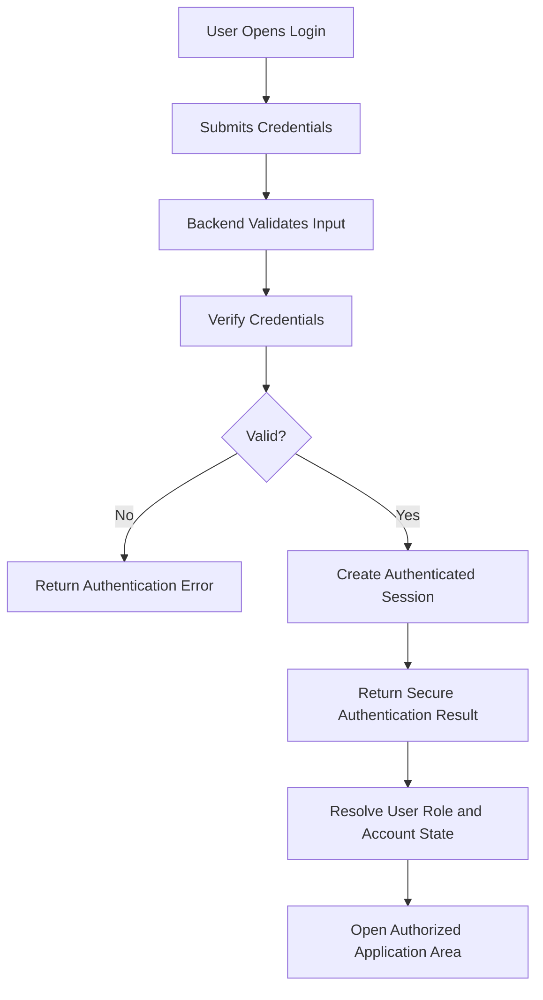
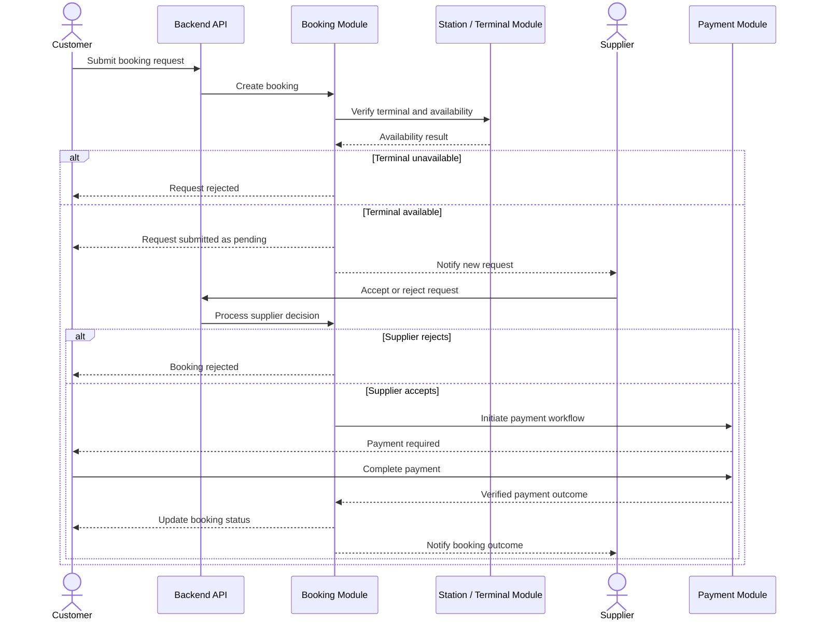
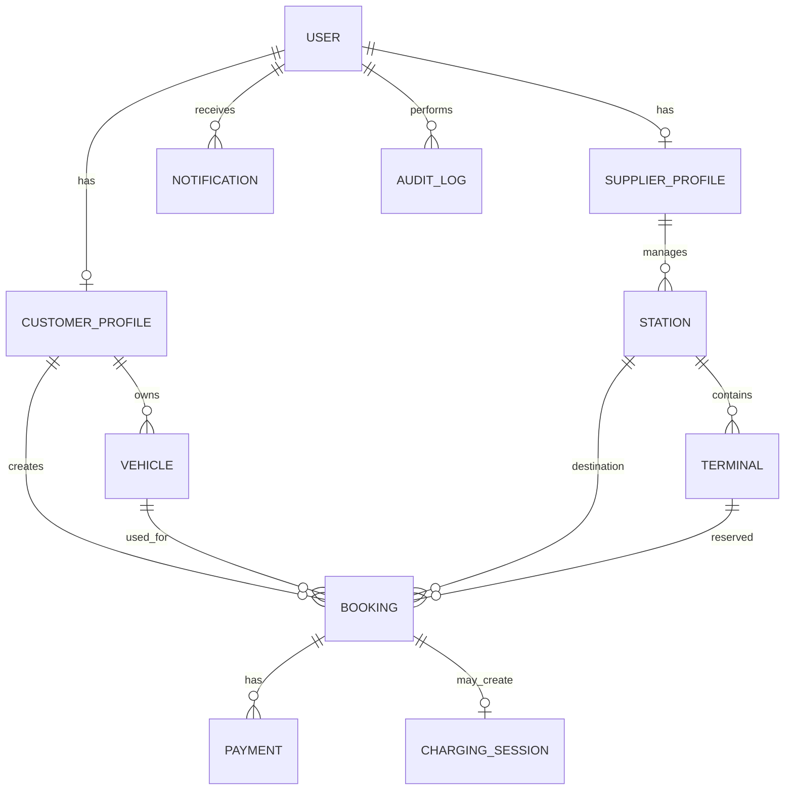
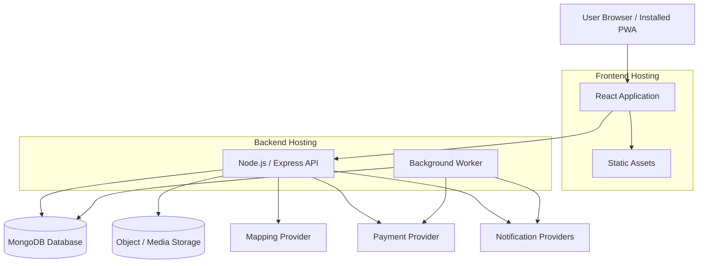

# SYSTEM ARCHITECTURE
## EV Charging Platform

**Document Type:** Technical Architecture Specification  
**Architecture Style:** Modular Monolith  
**Technology Foundation:** MERN Stack  
**Product Type:** Responsive Web Application with PWA Support

---

# 1. Purpose and Scope

This document defines the technical architecture of the EV Charging Platform.

It establishes how the complete system is structured, how its components communicate, how data moves through the application, and how the different business functionalities interact.

The architecture must support the platform's three primary user roles:

1. **Customer:** Discovers charging stations, registers vehicles, explores routes, requests bookings, and makes payments.
2. **Supplier:** Registers and manages charging stations, manages charging terminals, handles customer booking requests, and manages earnings.
3. **Super Admin:** Oversees customers, suppliers, stations, terminals, bookings, payments, and overall platform operations.

The system must support the following fundamental capabilities:

- User registration and authentication.
- Role-based access control.
- Customer vehicle management.
- Supplier and station management.
- Multiple charging terminals per station.
- Charging station discovery.
- Location-based search.
- Route calculation.
- Charging terminal availability.
- Booking requests and supplier responses.
- Payment processing.
- Notifications.
- Administrative management.
- Operational reporting.

This document covers the logical architecture and technical responsibilities of these components.

Detailed implementation technologies, package selections, and version decisions belong in `TECHSTACK.md`.

---

# 2. Architecture Objectives

The system architecture must satisfy the following objectives.

## 2.1 Maintainability

The codebase must remain organized as the platform grows.

Features should be separated into logical modules with clear responsibilities.

A change to booking functionality should not require unnecessary changes to unrelated vehicle or profile functionality.

## 2.2 Scalability

The architecture must support increasing numbers of:

- Customers.
- Suppliers.
- Charging stations.
- Charging terminals.
- Booking requests.
- Transactions.
- Location searches.
- Notifications.

The system should allow resource-intensive or independently scaling features to be separated later.

## 2.3 Security

The architecture must protect:

- User accounts.
- Authentication credentials.
- Personal information.
- Supplier records.
- Station ownership.
- Booking records.
- Payment information.
- Administrative operations.

Authorization must be enforced at the backend, not only through frontend navigation.

## 2.4 Data Integrity

The system must maintain valid relationships between:

- Users and roles.
- Suppliers and stations.
- Stations and terminals.
- Customers and vehicles.
- Customers and bookings.
- Bookings and terminals.
- Bookings and payments.

Operations must not create inconsistent records or duplicate transactions.

## 2.5 Reliability

Important operations must have predictable outcomes.

Examples include:

- Creating a booking.
- Accepting a booking.
- Rejecting a booking.
- Updating terminal availability.
- Processing payment.
- Completing a charging session.

The system must handle failed requests, repeated submissions, and temporary connectivity problems appropriately.

## 2.6 Extensibility

The architecture should support future integrations without requiring a complete redesign.

Potential future capabilities include:

- Charging hardware integration.
- Real-time terminal telemetry.
- Additional payment providers.
- Advanced route optimization.
- Push notifications.
- Mobile device integrations.
- Supplier analytics.
- Additional charging infrastructure.

These are extension points, not assumptions that all integrations will exist in the initial release.

---

# 3. Architectural Approach

## 3.1 Recommended Architecture: Modular Monolith

The initial platform should follow a modular monolithic architecture.

A modular monolith is a single deployable backend application organized into independent logical modules.

Each module owns a particular business responsibility and exposes controlled interfaces to other modules.

For example:

- Authentication handles identity and access.
- Station Management handles charging station records.
- Terminal Management handles charging terminal records.
- Booking Management handles booking lifecycles.
- Payment Management handles financial operations.
- Routing handles location and route calculations.

These modules operate within one backend application but should not become one large collection of tightly coupled code.

### Why not microservices initially?

A microservices architecture would introduce additional complexity:

- Multiple independently deployed services.
- Service-to-service communication.
- Distributed authentication.
- More complicated deployment.
- Distributed transaction problems.
- Additional monitoring requirements.
- More complex debugging and testing.

For the initial development stage, this complexity is unnecessary.

The platform can achieve meaningful modularity without deploying every business module separately.

### Architectural direction

The recommended progression is:

**Initial implementation:** Modular monolith.

**Growth stage:** Improve module boundaries, introduce background workers, and isolate resource-intensive operations where needed.

**Advanced stage:** Extract selected modules into independent services only when there is a clear technical or operational reason.

The architecture should permit this progression without requiring it prematurely.

---

# 4. High-Level System Architecture

The platform can be divided into five principal layers:

1. Client Layer.
2. API Layer.
3. Application and Business Logic Layer.
4. Data Layer.
5. External Integration Layer.

## 4.1 System Overview

```mermaid
flowchart TB
    USER["Platform Users"]

    subgraph CLIENT["CLIENT LAYER"]
        WEB["Responsive React Application"]
        PUBLIC["Public Website"]
        CUSTOMER["Customer Interface"]
        SUPPLIER["Supplier Interface"]
        ADMIN["Admin Interface"]
        PWA["PWA Capabilities"]
    end

    subgraph BACKEND["BACKEND APPLICATION"]
        API["Express REST API"]
        AUTH["Authentication and Authorization"]
        USERM["User Management"]
        VEHICLE["Vehicle Management"]
        STATION["Station Management"]
        TERMINAL["Terminal Management"]
        DISCOVERY["Station Discovery"]
        ROUTING["Routing Module"]
        BOOKING["Booking Management"]
        PAYMENT["Payment Management"]
        NOTIFY["Notification Management"]
        REPORT["Reporting and Administration"]
    end

    subgraph DATA["DATA LAYER"]
        DB[("MongoDB")]
        STORAGE[("File and Media Storage")]
    end

    subgraph EXTERNAL["EXTERNAL INTEGRATIONS"]
        MAP["Maps and Routing Provider"]
        GATEWAY["Payment Provider"]
        MSG["Email, SMS and Push Services"]
    end

    USER --> WEB
    WEB --> PUBLIC
    WEB --> CUSTOMER
    WEB --> SUPPLIER
    WEB --> ADMIN
    WEB --> PWA

    WEB --> API

    API --> AUTH
    API --> USERM
    API --> VEHICLE
    API --> STATION
    API --> TERMINAL
    API --> DISCOVERY
    API --> ROUTING
    API --> BOOKING
    API --> PAYMENT
    API --> NOTIFY
    API --> REPORT

    AUTH --> DB
    USERM --> DB
    VEHICLE --> DB
    STATION --> DB
    TERMINAL --> DB
    DISCOVERY --> DB
    BOOKING --> DB
    PAYMENT --> DB
    REPORT --> DB

    STATION --> STORAGE
    USERM --> STORAGE

    ROUTING --> MAP
    PAYMENT --> GATEWAY
    NOTIFY --> MSG
```



This represents the logical architecture. It does not imply that every module must be a separately deployed service.

## 4.2 Layer Responsibilities

### Client Layer

Responsible for the user-facing experience.

It includes:

- Public website.
- Customer application.
- Supplier application.
- Super Admin application.
- Authentication screens.
- Responsive interfaces.
- PWA functionality.

The client communicates with the backend through documented API interfaces.

### API Layer

Responsible for receiving and processing incoming requests.

Responsibilities include:

- Request routing.
- Input validation.
- Authentication middleware.
- Authorization middleware.
- Rate limiting.
- Request logging.
- Error handling.
- Response formatting.

The API layer should not contain all business logic.

### Application and Business Logic Layer

Responsible for implementing the platform's actual operations.

Examples:

- Registering a customer.
- Creating a station.
- Registering a terminal.
- Finding suitable charging stations.
- Creating a booking.
- Accepting a booking.
- Processing a payment.
- Sending a notification.

Business rules should be implemented here rather than being scattered across frontend components or database access functions.

### Data Layer

Responsible for persistent storage.

MongoDB stores the platform's main business records.

Additional storage may be required for uploaded files and media.

### External Integration Layer

Responsible for communicating with services outside the platform.

Examples:

- Map services.
- Routing services.
- Payment gateways.
- Email providers.
- SMS providers.
- Push notification services.

Integrations should be isolated behind internal interfaces so that changing providers does not require rewriting the core business modules.

---

# 5. Frontend Architecture

The frontend is a single responsive application.

It must support the public, customer, supplier, and admin experiences while preserving role-specific navigation and functionality.

## 5.1 Frontend Responsibilities

The frontend is responsible for:

- Rendering user interfaces.
- Managing interaction states.
- Handling forms.
- Performing client-side validation.
- Displaying server responses.
- Displaying loading and error states.
- Communicating with backend APIs.
- Displaying maps and route information.
- Managing navigation.
- Presenting real-time notifications where supported.

The frontend should not be responsible for enforcing business-critical security rules.

It must not independently decide that a booking is accepted or a payment is successful.

Those outcomes must come from authoritative backend responses.

## 5.2 Frontend Application Areas

The frontend should be logically separated into:

```text
Frontend
│
├── Public Application
│
├── Authentication
│
├── Customer Application
│   ├── Dashboard
│   ├── Vehicles
│   ├── Station Discovery
│   ├── Bookings
│   ├── Payments
│   └── Profile
│
├── Supplier Application
│   ├── Dashboard
│   ├── Stations
│   ├── Terminals
│   ├── Booking Requests
│   ├── Earnings
│   └── Profile
│
├── Super Admin Application
│   ├── Dashboard
│   ├── Users
│   ├── Suppliers
│   ├── Stations
│   ├── Terminals
│   ├── Bookings
│   ├── Payments
│   └── Reports
│
└── Shared Components
    ├── UI Components
    ├── Navigation
    ├── Layouts
    ├── Forms
    ├── Status Indicators
    └── Shared Utilities
```

This is a logical organization, not a requirement to create exactly these directories.

## 5.3 Role-Specific Application Shells

The application must provide separate layouts for the different user roles.

The same layout should be reused across all pages belonging to that role.

For example:

- All customer pages use the Customer Application shell.
- All supplier pages use the Supplier Application shell.
- All admin pages use the Super Admin shell.

Do not duplicate entire layouts for individual pages.

## 5.4 Frontend and Backend Separation

The frontend should communicate with backend services through API requests.

For example:

```text
Customer Interface
       |
       | HTTP Request
       v
Express API
       |
       v
Booking Module
       |
       v
MongoDB
```

The frontend must not directly connect to MongoDB or expose database credentials.

All protected operations must pass through the backend.

---

# 6. Backend Architecture

The backend is the central business processing layer.

It is responsible for authentication, authorization, validation, business operations, integrations, and data persistence.

The backend should use a modular structure.

## 6.1 Backend Module Overview

| Module | Primary responsibility |
|---|---|
| Authentication | Identity verification and session management |
| User Management | Customer and supplier account management |
| Authorization | Role and resource permission checks |
| Vehicle Management | Customer vehicle records |
| Station Management | Supplier charging station records |
| Terminal Management | Charging terminal records and operational state |
| Station Discovery | Searching and filtering stations |
| Routing | Location-based route calculation |
| Booking Management | Booking requests and state transitions |
| Charging Session Management | Actual charging activity, where tracked |
| Payment Management | Payment operations and transaction records |
| Notification Management | In-app and external notifications |
| Administration | Platform oversight and administrative actions |
| Reporting | Operational and financial summaries |
| Audit | Important administrative and operational action history |

These are logical business modules within the backend.

## 6.2 Module Independence

Each module should have:

- Clearly defined responsibilities.
- Its own business logic.
- Controlled interfaces.
- Appropriate validation.
- A defined relationship with other modules.

Modules may use shared infrastructure, such as database connections and authentication middleware.

However, they should not freely modify each other's internal data structures or bypass business rules.

For example, the Payment module should communicate with Booking Management through a defined interface rather than directly changing booking records through arbitrary database updates.

## 6.3 Suggested Backend Request Flow

```text
Incoming Request
       |
       v
Express Router
       |
       v
Authentication Middleware
       |
       v
Authorization Middleware
       |
       v
Request Validation
       |
       v
Controller
       |
       v
Application Service
       |
       v
Domain Rules and Business Logic
       |
       v
Repository / Data Access
       |
       v
MongoDB
       |
       v
Formatted API Response
```

### Router

Maps an HTTP endpoint to the appropriate controller.

### Middleware

Performs cross-cutting operations such as:

- Authentication.
- Authorization.
- Validation.
- Rate limiting.
- Error handling.

### Controller

Receives the request, extracts validated input, invokes the appropriate application service, and prepares the response.

Controllers should remain relatively thin.

### Application Service

Coordinates the requested operation.

For example, a booking service may:

- Verify the customer.
- Check station and terminal relationships.
- Validate booking details.
- Check availability.
- Create the booking.
- Trigger relevant events.

### Domain Logic

Enforces business rules.

For example:

- A customer cannot accept their own supplier booking request.
- A supplier cannot manage another supplier's station.
- An unavailable terminal cannot be booked.
- A rejected booking cannot be paid as an accepted booking.
- A payment cannot be treated as successful without valid confirmation.

### Repository or Data Access Layer

Handles database operations and provides a controlled way for business modules to access persistent data.

---

# 7. Core Business Modules

## 7.1 Authentication and Identity Management

This module handles the identity of every platform user.

Responsibilities:

- Customer registration.
- Supplier registration.
- Login.
- Logout.
- Password hashing.
- Password recovery.
- Account verification.
- Token or session management.
- Authentication state.
- Account status checks.

### Account Types

The initial role model:

```text
User
 ├── Customer
 ├── Supplier
 └── Super Admin
```

A user should have an explicitly defined role.

Role-specific profile information should remain logically separated from common identity information.

### Authentication Flow



### Important Rules

- Passwords must be stored as secure hashes, never plaintext.
- Protected routes require authentication.
- Authentication must be checked by the backend.
- Account state must be considered during authorization.
- Token expiration and renewal must be handled securely.
- Logout must invalidate or revoke the relevant authentication session according to the chosen strategy.

The exact authentication strategy is defined in the technical stack and security implementation decisions.

---

## 7.2 User Management

This module manages shared account information and role-specific account profiles.

Responsibilities:

- User information.
- Account status.
- Contact information.
- Profile management.
- Role assignment.
- Supplier account information.
- Account verification states, where required.

A customer and supplier may have different information requirements.

Do not place all role-specific details into one poorly structured user record.

The common account identity and role-specific profile data should have a clear relationship.

---

## 7.3 Vehicle Management

Vehicle Management handles customer-owned vehicle records.

Responsibilities:

- Register a vehicle.
- Edit vehicle information.
- Remove a vehicle.
- Retrieve a customer's vehicles.
- Identify a preferred vehicle where supported.
- Store charging compatibility information.

A vehicle must be associated with its owner.

The backend must verify ownership whenever a customer reads or modifies a vehicle.

Vehicle information may influence charging station recommendations and compatibility checks.

The exact vehicle specification fields should be finalized in the data model document.

---

## 7.4 Station Management

Station Management handles supplier charging station records.

A supplier may own or manage multiple stations.

Responsibilities:

- Register a station.
- Update station information.
- Retrieve supplier-owned stations.
- Manage station location.
- Manage station-level operational information.
- View associated terminals.
- Update supported station availability information.

### Ownership Structure

```text
Supplier
   |
   ├── Station A
   │     ├── Terminal 1
   │     ├── Terminal 2
   │     └── Terminal 3
   │
   ├── Station B
   │     ├── Terminal 1
   │     └── Terminal 2
   │
   └── Station C
         └── Terminal 1
```

This hierarchy is fundamental to the system.

A station belongs to a supplier, and its terminals belong to that station.

The backend must enforce these relationships.

A supplier must not be able to associate a terminal with a station that belongs to another supplier.

---

## 7.5 Terminal Management

Terminal Management handles individual charging units associated with stations.

Responsibilities:

- Register terminals.
- Update terminal information.
- Retrieve terminals by station.
- Manage supported availability states.
- Manage maintenance or operational states.
- Expose terminal information to discovery and booking functionality.

### Station Versus Terminal

These concepts must remain distinct.

A station represents a physical charging location or facility.

A terminal represents an individual charging unit or charging point associated with that station.

Example:

A supplier registers one station with four charging terminals.

The customer discovers the station but ultimately selects a suitable terminal when creating a booking, subject to the platform's booking rules.

### Terminal Availability

Terminal state and booking state are related but separate concepts.

Possible terminal operational states:

- AVAILABLE.
- OCCUPIED.
- UNAVAILABLE.
- MAINTENANCE.

The platform must define which transitions are permitted and which source is authoritative.

For the initial version, availability may be maintained through supplier or administrative operations if live hardware telemetry is not available.

Future hardware integration may provide automated status updates.

The architecture must not assume that every terminal is physically connected to the platform from day one.

---

## 7.6 Station Discovery

Station Discovery allows customers to find suitable charging locations.

Responsibilities:

- Search stations.
- Search by location.
- Filter stations.
- Retrieve station details.
- Retrieve associated terminals.
- Retrieve relevant availability.
- Retrieve pricing and charging information where provided.
- Support nearby station discovery.

### Discovery Flow

```text
Customer
   |
   v
Select or Enter Location
   |
   v
Station Discovery API
   |
   v
Retrieve Relevant Stations
   |
   v
Apply Search and Filter Rules
   |
   v
Retrieve Relevant Terminal Information
   |
   v
Return Station Results
   |
   v
Display List and Map
```

Discovery should not expose another supplier's private operational information.

Only the information intended to be publicly discoverable should be returned to customers.

### Search Capabilities

Potential search criteria include:

- Location.
- Distance.
- Station availability.
- Terminal availability.
- Supported charging specifications.
- Pricing.
- Other approved station attributes.

The initial search scope should be based on actual product requirements rather than implementing every possible filter.

---

## 7.7 Routing and Route Calculation

Routing is a separate module because it has its own data requirements and calculations.

Responsibilities:

- Accept starting and destination locations.
- Retrieve route information.
- Identify suitable station destinations.
- Calculate or retrieve route distances.
- Retrieve estimated travel times where supported.
- Return route geometry for map visualization.

### Routing Architecture

```text
Customer
   |
   v
Select Starting Location
   |
   v
Choose or Discover Charging Stations
   |
   v
Routing Module
   |
   +------> Road / Mapping Data
   |
   +------> Routing Algorithm or Provider
   |
   v
Route Information
   |
   v
Display Route on Map
```

### Dijkstra's Algorithm

Dijkstra's algorithm may be used when the platform has an appropriate weighted graph.

A graph contains:

- Vertices representing locations.
- Edges representing connections.
- Weights representing distance, time, or another defined cost.

The algorithm finds a minimum-cost path from a source vertex to a destination vertex when edge weights are non-negative.

However, an important distinction must be maintained:

**Dijkstra's algorithm cannot independently calculate real-world road routes without suitable road-network graph data.**

For road navigation, the platform needs a valid road graph or a mapping/routing provider.

The architecture should therefore separate:

1. Routing algorithm.
2. Road-network or routing data source.
3. Map visualization.
4. Station discovery.

The platform can implement an internal Dijkstra-based algorithm when the required graph data is available, or integrate a routing provider through an adapter.

Do not apply Dijkstra directly to a list of charging stations and assume that the result represents the shortest road route.

### Potential Future Routing Improvements

- Multiple route alternatives.
- Travel-time optimization.
- Charging compatibility constraints.
- Vehicle range consideration.
- Battery-aware route planning.
- Multi-stop charging recommendations.

These are future extensions unless explicitly included in the initial requirements.

---

## 7.8 Booking Management

Booking Management is one of the most important modules in the entire platform.

It coordinates customer requests, supplier decisions, terminal availability, and the subsequent payment process.

Responsibilities:

- Create booking requests.
- Retrieve customer bookings.
- Retrieve supplier booking requests.
- Validate station and terminal information.
- Check booking availability.
- Accept bookings.
- Reject bookings.
- Cancel bookings.
- Track booking status.
- Complete bookings.

### Booking Flow



This illustrates the intended business sequence. Actual payment capture timing and booking transitions must follow the finalized payment policy.

### Booking Lifecycle

The booking state machine should distinguish supplier acceptance from final payment confirmation.

Recommended conceptual states:

| Status | Meaning |
|---|---|
| PENDING_SUPPLIER | Request submitted and awaiting supplier response |
| REJECTED | Supplier rejected the request |
| ACCEPTED_AWAITING_PAYMENT | Supplier accepted, but required payment is not confirmed |
| CONFIRMED | Required booking confirmation conditions are satisfied |
| IN_PROGRESS | Charging activity has started, where tracked |
| COMPLETED | Booking or charging service is completed |
| CANCELLED | Booking was cancelled according to permitted rules |
| EXPIRED | Booking could not proceed within its allowed period |

A transition must be explicitly defined.

For example:

```text
PENDING_SUPPLIER
       |
       +------> REJECTED
       |
       +------> ACCEPTED_AWAITING_PAYMENT
                        |
                        +------> CONFIRMED
                        |
                        +------> EXPIRED

CONFIRMED
       |
       +------> IN_PROGRESS
                     |
                     +------> COMPLETED

Eligible states
       |
       +------> CANCELLED
```

Not every status transition should be available to every role.

The backend must validate the current state before allowing a transition.

### Booking and Charging Session Separation

A booking represents a reservation or accepted request.

A charging session represents the actual delivery of charging service.

These should be separate concepts.

A booking may exist without a charging session having started.

A session may record:

- Start time.
- End time.
- Actual charging duration.
- Energy delivered, if metering exists.
- Relevant terminal.
- Session completion state.

The initial system may not have hardware-level session measurements. In that case, the platform should only record the information that can actually be verified.

### Availability and Concurrency

The system must prevent two incompatible bookings from consuming the same terminal availability.

Availability must be checked at the backend.

The platform must define the booking time model and availability rules before implementation.

If bookings use time slots, overlapping reservations must be prevented through appropriate atomic operations and database constraints.

A simple frontend availability check is not sufficient because two customers may submit requests at nearly the same time.

---

## 7.9 Payment Management

Payment Management handles the financial workflow between customer booking activity and supplier revenue.

Responsibilities:

- Initiate payment.
- Create payment records.
- Communicate with the payment gateway.
- Verify payment outcomes.
- Process payment webhooks.
- Track payment status.
- Prevent duplicate processing.
- Provide transaction history.
- Support refunds where required by the business rules.
- Support supplier earning and settlement records where implemented.

### Payment Lifecycle

```text
Supplier Accepts Booking
          |
          v
Payment Required
          |
          v
Create Payment Attempt
          |
          v
Payment Provider
          |
          v
Verify Authoritative Result
          |
          +------> Failed / Pending
          |
          +------> Successful
                      |
                      v
              Update Payment Record
                      |
                      v
              Update Booking Flow
                      |
                      v
              Notify Customer and Supplier
```

### Payment State

Payment status must remain separate from booking status.

Potential payment states:

- PENDING.
- PROCESSING.
- SUCCEEDED.
- FAILED.
- CANCELLED.
- REFUNDED.
- PARTIALLY_REFUNDED, if supported.

### Payment Provider Integration

The payment integration must be isolated.

The core payment module should not depend directly on one provider's internal API structure.

Instead, use a provider adapter.

Conceptually:

```text
Payment Management
        |
        v
Payment Provider Interface
        |
        +------> Provider A
        |
        +------> Provider B
```

The actual payment provider must be selected separately.

### Financial Integrity

Important requirements:

- Verify payment results on the backend.
- Treat gateway webhooks as untrusted until signature and authenticity checks pass.
- Handle duplicate webhooks safely.
- Use idempotency for payment creation and confirmation where supported.
- Never store raw card details.
- Keep financial records traceable.
- Do not mark bookings as paid based solely on frontend input.

### Supplier Earnings

Supplier earnings should be calculated from verified transaction and business records.

The platform must distinguish:

- Customer payment.
- Platform fee or commission, if applicable.
- Supplier payable amount.
- Settlement status.

The commission model, settlement rules, and refund policies require separate business decisions.

They must not be invented inside the implementation.

---

## 7.10 Notification Management

Notifications communicate important events between the platform and its users.

Responsibilities:

- Create in-app notifications.
- Notify suppliers of new booking requests.
- Notify customers of booking decisions.
- Notify users of relevant payment events.
- Track notification read status.
- Integrate with supported external notification providers.

### Notification Event Examples

| Event | Recipient |
|---|---|
| Booking request submitted | Relevant supplier |
| Supplier accepts booking | Customer |
| Supplier rejects booking | Customer |
| Payment succeeds | Customer and relevant supplier |
| Payment fails | Customer |
| Booking cancelled | Relevant parties |
| Important terminal status change | Relevant supplier or admin |

Notification generation should follow successful business operations.

For example, a supplier notification should not be sent before the booking request has been successfully recorded.

### Real-Time Updates

For timely updates, the backend may provide a real-time communication layer.

WebSockets or a suitable event-based transport can be used where the user experience requires immediate delivery.

A possible implementation is Socket.IO, with ordinary HTTP APIs remaining responsible for creating and updating business records.

Real-time messages are delivery mechanisms, not the authoritative source of booking or payment state.

The client should still retrieve authoritative records from the backend.

The in-app notification system must remain usable even when browser push notifications are unavailable.

---

## 7.11 Administration Module

The administration module provides privileged platform oversight.

Responsibilities:

- Manage customer accounts.
- Manage supplier accounts.
- Review supplier verification where required.
- Inspect station records.
- Inspect terminal records.
- Monitor bookings.
- Inspect payment records.
- Review platform operations.
- Manage administrative settings.
- Access relevant audit information.

Administrative functionality must use explicit permissions.

Not every administrative action should automatically be available to every administrative account if the platform introduces additional admin permission levels.

Sensitive actions must be logged.

---

## 7.12 Reporting and Analytics

Reporting provides summarized views of platform operations.

Potential reports include:

- Customer growth.
- Supplier growth.
- Station distribution.
- Terminal availability.
- Booking volumes.
- Completed charging activity.
- Payment summaries.
- Supplier earnings.

Reports must derive from actual database records.

Do not calculate financial metrics from frontend display values.

For large datasets, reporting operations may use optimized queries, aggregation pipelines, precomputed summaries, or background processing.

---

# 8. Database Architecture

MongoDB will be the primary persistent database.

The data model must represent the platform's business entities and their relationships clearly.

## 8.1 Main Entity Relationships

The central entity structure is:



This is a conceptual relationship diagram.

The exact MongoDB collection structure and optional relationships must be finalized in the database design document.

## 8.2 Core Data Entities

| Entity | Responsibility |
|---|---|
| User | Common authentication and identity information |
| Customer Profile | Customer-specific account information |
| Supplier Profile | Supplier-specific account and business information |
| Vehicle | Customer-owned vehicle information |
| Station | Supplier-managed charging location |
| Terminal | Charging unit associated with a station |
| Booking | Customer charging booking request |
| Payment | Financial transaction records |
| Charging Session | Actual charging activity, if tracked |
| Notification | User notification records |
| Audit Log | Important recorded system actions |

Additional entities may be introduced according to actual business requirements.

## 8.3 MongoDB Data Modeling Principles

The architecture should consider the following principles.

### Model Relationships Intentionally

Use document embedding for tightly related information that is usually retrieved together and has a suitable lifecycle.

Use references for independently managed entities with meaningful relationships.

For example:

- Stations and terminals should remain separately manageable entities.
- Bookings should reference the relevant customer, station, and terminal.
- Payments should have a clear relationship with their associated booking.

Do not embed entire payment histories inside user documents.

### Ownership

Every supplier-owned station must have a verifiable supplier relationship.

Every terminal must have a verifiable parent station.

Every customer-owned vehicle must have a verifiable customer relationship.

The backend must validate these relationships when reading or modifying records.

### Data Consistency

Important operations must avoid partial updates.

Where an operation updates multiple related records, use an appropriate consistency strategy.

MongoDB transactions may be used for workflows that require atomic multi-document updates, provided the database deployment supports them.

For critical operations, prefer a consistent state transition over several unrelated database updates.

### Indexing

Indexes should support common access patterns.

Examples:

- User email lookup.
- Supplier station lookup.
- Terminal lookup by station.
- Booking lookup by customer.
- Booking lookup by supplier or station.
- Payment lookup by booking.
- Location-based station discovery.
- Notification retrieval by user.

Index design must follow actual query patterns and data volume.

Avoid adding excessive indexes without considering their storage and write-performance costs.

### Geospatial Data

Station coordinates should be stored in a format suitable for geospatial queries.

MongoDB geospatial indexes can support nearby station searches.

The precise location data structure should be defined in the database schema.

---

# 9. API Architecture

The frontend and backend should communicate through documented APIs.

The initial architecture should use RESTful HTTP APIs with JSON payloads.

## 9.1 API Responsibilities

The API layer should provide:

- Authentication endpoints.
- User profile endpoints.
- Vehicle endpoints.
- Station endpoints.
- Terminal endpoints.
- Station discovery endpoints.
- Routing endpoints.
- Booking endpoints.
- Payment endpoints.
- Notification endpoints.
- Administrative endpoints.

## 9.2 API Versioning

Use a versioned API prefix.

Conceptual example:

```text
/api/v1/
```

This provides an organized way to evolve API contracts without creating unnecessary compatibility problems.

## 9.3 Example Endpoint Organization

The following is a conceptual endpoint structure.

### Authentication

```text
POST   /api/v1/auth/register
POST   /api/v1/auth/login
POST   /api/v1/auth/logout
POST   /api/v1/auth/refresh
POST   /api/v1/auth/forgot-password
POST   /api/v1/auth/reset-password
```

### Customers and Vehicles

```text
GET    /api/v1/customers/me
PATCH  /api/v1/customers/me

GET    /api/v1/vehicles
POST   /api/v1/vehicles
GET    /api/v1/vehicles/:vehicleId
PATCH  /api/v1/vehicles/:vehicleId
DELETE /api/v1/vehicles/:vehicleId
```

### Stations

```text
GET    /api/v1/stations
GET    /api/v1/stations/:stationId
POST   /api/v1/supplier/stations
GET    /api/v1/supplier/stations
PATCH  /api/v1/supplier/stations/:stationId
```

### Terminals

```text
GET    /api/v1/stations/:stationId/terminals
POST   /api/v1/supplier/stations/:stationId/terminals
GET    /api/v1/supplier/terminals/:terminalId
PATCH  /api/v1/supplier/terminals/:terminalId
```

### Discovery and Routing

```text
GET    /api/v1/discovery/stations
GET    /api/v1/discovery/stations/nearby
POST   /api/v1/routes
```

### Bookings

```text
POST   /api/v1/bookings
GET    /api/v1/bookings
GET    /api/v1/bookings/:bookingId

GET    /api/v1/supplier/bookings
POST   /api/v1/supplier/bookings/:bookingId/accept
POST   /api/v1/supplier/bookings/:bookingId/reject

POST   /api/v1/bookings/:bookingId/cancel
```

### Payments

```text
POST   /api/v1/bookings/:bookingId/payments
GET    /api/v1/payments
GET    /api/v1/payments/:paymentId
POST   /api/v1/webhooks/payments/:provider
```

### Administration

```text
GET    /api/v1/admin/users
GET    /api/v1/admin/suppliers
GET    /api/v1/admin/stations
GET    /api/v1/admin/terminals
GET    /api/v1/admin/bookings
GET    /api/v1/admin/payments
GET    /api/v1/admin/audit-logs
```

These examples define resource organization, not finalized endpoint contracts.

Each endpoint must receive the appropriate authentication, authorization, validation, and business-rule checks.

## 9.4 Standard API Response Structure

Responses should follow a consistent format.

Successful response example:

```json
{
  "success": true,
  "message": "Booking request submitted successfully",
  "data": {
    "bookingId": "example-booking-id",
    "status": "PENDING_SUPPLIER"
  }
}
```

Error response example:

```json
{
  "success": false,
  "message": "The selected terminal is unavailable",
  "error": {
    "code": "TERMINAL_UNAVAILABLE"
  }
}
```

Avoid exposing stack traces, private database information, or internal implementation details.

## 9.5 API Validation

Validate:

- Required fields.
- Data types.
- Identifier formats.
- Allowed status transitions.
- User permissions.
- Resource ownership.
- Relevant business constraints.

Validation must occur on the backend even when equivalent validation exists in the frontend.

---

# 10. Event-Driven Operations

Some platform operations generate other actions.

For example:

- A booking creates a supplier notification.
- Supplier acceptance triggers a customer update.
- A verified payment updates the booking workflow.
- A booking cancellation may release terminal availability.

The architecture should represent these events explicitly.

## 10.1 Important Domain Events

Examples:

```text
UserRegistered
SupplierRegistered
StationCreated
TerminalRegistered

BookingRequested
BookingAccepted
BookingRejected
BookingCancelled
BookingExpired

PaymentInitiated
PaymentSucceeded
PaymentFailed

ChargingSessionStarted
ChargingSessionCompleted

NotificationCreated
```

These are conceptual event names.

The actual event payloads and ownership rules should be defined during implementation.

## 10.2 Event Processing

An event is produced after the relevant business operation succeeds.

Other modules can respond to that event.

Example:

```text
Booking Module
      |
      v
Booking Successfully Created
      |
      v
BookingRequested Event
      |
      +------> Notification Module
      |
      +------> Real-Time Delivery
      |
      +------> Audit / Activity Recording
```

## 10.3 Reliable Event Handling

Events related to important business operations must not disappear silently.

As the platform grows, a reliable event publication approach such as the transactional outbox pattern should be considered.

The outbox pattern allows a business update and an event record to be committed together, with a worker delivering the event afterward.

This is particularly useful for:

- Booking notifications.
- Payment outcome notifications.
- Booking expiry.
- Operational status changes.

For the initial implementation, event handling can remain inside the modular backend, but critical workflows should be designed with reliable delivery in mind.

---

# 11. Background Processing

Some operations should not execute inside a normal user-facing HTTP request.

Examples:

- Sending external notifications.
- Processing payment webhooks.
- Expiring old booking requests.
- Generating reports.
- Synchronizing external information.
- Processing future telemetry events.

A background worker can process these operations.

## 11.1 Initial Approach

The first implementation can use the backend application plus a separate worker process when necessary.

Both can share the same codebase and database.

The worker should not duplicate the business rules implemented by the main application.

## 11.2 Future Background Queue

If workloads increase, introduce a durable job queue.

Potential jobs:

- Send booking notification.
- Send payment result notification.
- Expire booking.
- Generate report.
- Process payment callback.
- Update external records.

Queue implementation technology should be finalized in the technical stack document.

## 11.3 Scheduling

Scheduled jobs may be needed for:

- Expiring pending requests.
- Cleaning up temporary data.
- Periodic summaries.
- Reconciliation operations.

Do not rely on an in-memory timer in a single application instance for operations that must remain reliable across application restarts or multiple replicas.

Use a persistent scheduler or job queue when reliability is required.

---

# 12. External Integration Architecture

External providers must be integrated through dedicated adapters.

The platform should not mix provider-specific code with its core business logic.

## 12.1 Maps and Routing

Responsibilities:

- Geocoding.
- Map display.
- Location search.
- Route retrieval.
- Route geometry.
- Distance and estimated travel time where supported.

The architecture should define an internal mapping interface.

This allows the project to change mapping or routing providers without rewriting station discovery and booking logic.

The exact provider remains a separate technical decision.

## 12.2 Payment Provider

The payment integration should sit behind the Payment Management module.

The rest of the platform should interact with the internal payment interface rather than depending directly on a gateway's response formats.

Provider selection, available payment methods, currency handling, fees, refunds, and settlement rules must be finalized separately.

## 12.3 Email and SMS

The notification module should use provider adapters for external delivery.

Email may be used for:

- Account verification.
- Password recovery.
- Booking updates.
- Relevant transaction information.

SMS may be used for supported critical notifications.

The platform must respect the user's notification preferences and applicable communication rules.

## 12.4 Push Notifications

Browser push notifications should use the PWA notification capabilities where supported.

They should supplement, not replace, the internal notification system.

## 12.5 Charging Hardware Integration

A future hardware integration layer may support:

- Terminal telemetry.
- Operational status.
- Charging session initiation.
- Charging session measurements.
- Energy consumption.
- Remote terminal actions where supported.

However, these capabilities depend on actual hardware, communication protocols, device support, and supplier agreements.

The initial architecture must not assume that terminals can communicate directly with the platform.

Where no hardware connection exists, operational status may be maintained through supplier or administrative interfaces.

---

# 13. Security Architecture

Security must be applied across every layer.

## 13.1 Authentication

Use a secure authentication strategy.

Recommended considerations:

- Secure password hashing.
- HTTPS.
- Protected authentication sessions.
- Access-token expiration where token-based authentication is used.
- Refresh-token rotation where applicable.
- Secure logout.
- Account verification.
- Protection against brute-force attempts.

For browser sessions, secure HttpOnly cookies are a suitable approach to evaluate. Cookie-based authentication must also include appropriate CSRF protection and cookie settings.

Avoid storing long-lived authentication secrets in ordinary browser local storage.

The precise implementation must follow the authentication design selected in the technical stack.

## 13.2 Authorization

Use role-based access control.

Initial roles:

- CUSTOMER.
- SUPPLIER.
- SUPER_ADMIN.

However, role checks alone are insufficient.

The system must also verify resource ownership.

Examples:

- A customer may access only their own vehicle records.
- A supplier may manage only their own stations.
- A supplier may manage terminals belonging to their stations.
- A customer may access only authorized booking information.
- An admin may perform privileged operations according to administrative permissions.

## 13.3 Input Security

- Validate incoming input.
- Sanitize relevant user-generated content.
- Prevent injection vulnerabilities.
- Validate uploaded files.
- Enforce file type and size restrictions.
- Protect against unsafe redirects.
- Apply appropriate rate limits.

## 13.4 Payment Security

- Do not store raw payment card data.
- Verify gateway callbacks.
- Authenticate webhook signatures.
- Prevent duplicate transactions.
- Maintain transaction records.
- Apply proper authorization to payment history.

## 13.5 Administrative Security

Administrative operations must be protected.

Important changes should generate audit records.

Potential controls include:

- Restricted administrative access.
- Strong authentication.
- Additional verification for sensitive actions.
- Action-level authorization.
- Audit logging.

## 13.6 Secrets and Configuration

Never hardcode:

- Database credentials.
- API keys.
- Payment secrets.
- Authentication secrets.
- Private integration tokens.

Use environment-based configuration and an appropriate secret-management mechanism.

Never expose server-side secrets through frontend environment variables or browser-delivered code.

---

# 14. Audit and Logging Architecture

The application should record operational information needed for debugging, security, and accountability.

## 14.1 Application Logging

Record:

- Request failures.
- Application errors.
- External integration failures.
- Background job failures.
- Important application warnings.

Logs must avoid exposing passwords, tokens, payment credentials, or unnecessary personal information.

## 14.2 Audit Logging

Audit logs should record significant actions.

Examples:

- Supplier station registration.
- Station modification.
- Terminal status modification.
- Booking acceptance or rejection.
- Administrative account changes.
- Administrative record modification.
- Sensitive payment-related operations.

A suitable audit record should identify:

- Actor.
- Action.
- Affected entity.
- Timestamp.
- Relevant outcome.
- Context necessary for investigation.

Audit records should not be treated as ordinary editable user-generated records.

## 14.3 Error Monitoring

The system should have visibility into:

- Frontend errors.
- API errors.
- Database failures.
- External provider failures.
- Payment workflow failures.
- Background worker failures.

Error monitoring should be introduced as part of production readiness.

---

# 15. Deployment Architecture

The platform should be deployed using separate frontend and backend runtime responsibilities, even when both belong to the same product.

## 15.1 Deployment Overview



This is a logical deployment proposal, not a commitment to a particular hosting vendor.

## 15.2 Frontend Hosting

The frontend should be delivered through an appropriate web hosting platform or CDN.

Responsibilities:

- Serve the responsive application.
- Deliver static assets.
- Support application routing.
- Provide HTTPS.
- Support PWA asset delivery.

## 15.3 Backend Hosting

The backend must run in an environment capable of hosting the Node.js/Express application.

Responsibilities:

- Receive API requests.
- Execute business operations.
- Communicate with MongoDB.
- Process external integrations.
- Handle authenticated requests.
- Deliver real-time events where enabled.

## 15.4 Database Hosting

MongoDB should be hosted in a reliable environment with:

- Authentication enabled.
- Network access restrictions.
- Backup facilities.
- Monitoring.
- Appropriate connection management.

## 15.5 File Storage

Uploaded files and media should use a dedicated storage service where appropriate.

Do not depend on local application-server storage for files that must remain available after redeployment or when multiple application instances are running.

The actual storage provider remains to be selected.

## 15.6 Environment Separation

Maintain separate configuration for:

- Development.
- Testing.
- Staging, if used.
- Production.

Production credentials and data must not be shared casually with development environments.

---

# 16. Reliability and Fault Handling

The platform must expect that failures can occur.

Examples:

- Database temporarily unavailable.
- Payment provider unavailable.
- Mapping service timeout.
- Notification delivery failure.
- Browser connection lost.
- User submits a request multiple times.
- Two customers attempt to book the same terminal.

## 16.1 API Failures

Return consistent error responses.

Do not expose internal details.

Provide appropriate recovery behavior in the frontend.

## 16.2 External Provider Failures

If the map provider is unavailable, station information should remain accessible where possible.

If the payment provider fails, do not mark the transaction as successful.

If a notification provider fails, preserve the underlying business operation and retry delivery through a reliable mechanism where appropriate.

## 16.3 Duplicate Requests

Critical operations should support idempotent processing where appropriate.

A repeated booking or payment request must not automatically create duplicate business records.

Use stable request identifiers or idempotency keys for operations that require this protection.

## 16.4 Database Consistency

Use transactions, atomic updates, or other appropriate consistency mechanisms for multi-record business operations.

The implementation must carefully define which changes need to happen together.

---

# 17. Performance and Scalability

The architecture should be efficient from the beginning without introducing unnecessary infrastructure.

## 17.1 Database Performance

- Add indexes based on query patterns.
- Avoid unnecessary document retrieval.
- Use pagination for large result sets.
- Optimize geospatial queries.
- Limit returned fields where appropriate.
- Avoid expensive repeated aggregation.

## 17.2 API Performance

- Validate requests before expensive operations.
- Avoid excessive database round trips.
- Add pagination.
- Apply rate limiting.
- Use appropriate timeouts.
- Cache only suitable data.
- Keep external integration calls controlled.

## 17.3 Frontend Performance

- Load large features when needed.
- Avoid downloading unnecessary libraries.
- Optimize images.
- Use code splitting where beneficial.
- Keep map initialization scoped.
- Avoid unnecessary data fetching.

## 17.4 Caching

Caching may be introduced for:

- Public station information.
- Static assets.
- Non-sensitive reference data.
- Suitable aggregated information.

Do not treat cached availability or payment information as authoritative.

Live information must be verified against the backend.

## 17.5 Horizontal Scaling

The initial backend should be designed so additional application instances can run when required.

Avoid unnecessary dependence on in-memory state.

Shared state should be stored in appropriate persistent systems or distributed infrastructure.

If real-time connections or background jobs are introduced, their coordination must be designed for multiple instances.

---

# 18. Core End-to-End System Workflows

The following workflows connect the system's major modules.

## 18.1 Customer Registration

```text
Customer
   |
   v
Registration Interface
   |
   v
Authentication API
   |
   v
Validate Registration Data
   |
   v
Create User Account
   |
   v
Create Customer Profile
   |
   v
Apply Verification Requirements
   |
   v
Return Registration Result
   |
   v
Customer Application
```

Account and profile creation must preserve their relationship.

## 18.2 Supplier Registration and Station Creation

```text
Supplier
   |
   v
Supplier Registration
   |
   v
Supplier Account and Profile
   |
   v
Verification / Approval, if required
   |
   v
Supplier Application
   |
   v
Register Station
   |
   v
Station Management Module
   |
   v
Create Station Record
   |
   v
Register Charging Terminals
   |
   v
Associate Terminals with Station
```

The system must validate supplier ownership and station-terminal relationships.

## 18.3 Customer Station Discovery

```text
Customer
   |
   v
Choose Location
   |
   v
Discovery API
   |
   v
Retrieve Nearby Stations
   |
   v
Retrieve Public Station Information
   |
   v
Retrieve Relevant Terminal Availability
   |
   v
Optional Routing Request
   |
   v
Display Results and Route
```

Location permission is optional. Manual location search must remain available.

## 18.4 Booking Request

```text
Customer
   |
   v
Select Station
   |
   v
Select Terminal
   |
   v
Submit Booking
   |
   v
Backend Validation
   |
   v
Check Availability and Ownership
   |
   v
Create Pending Booking
   |
   v
Notify Supplier
```

The booking must not be considered accepted simply because a request was submitted.

## 18.5 Supplier Booking Response

```text
Supplier
   |
   v
Receives Booking Request
   |
   v
Reviews Details
   |
   v
Accept / Reject
   |
   v
Booking Module Validates Transition
   |
   +------> Rejected
   |
   +------> Accepted
                  |
                  v
             Payment Workflow
                  |
                  v
             Booking Confirmation
```

The exact transition depends on the selected payment policy.

## 18.6 Payment Processing

```text
Customer
   |
   v
Payment Interface
   |
   v
Payment API
   |
   v
Create Payment Attempt
   |
   v
Payment Provider
   |
   v
Verify Result
   |
   v
Update Transaction Record
   |
   v
Update Booking Workflow
   |
   v
Notify Relevant Users
```

A frontend redirect alone must never determine the authoritative payment status.

---

# 19. Future Architecture Extensions

The initial architecture should provide room for future enhancements.

These are optional development directions rather than mandatory first-release features.

## 19.1 Charging Hardware and IoT

Potential integration:

```text
Charging Terminal
       |
       v
Communication Gateway
       |
       v
Hardware Integration Module
       |
       v
Terminal Management
       |
       v
Availability and Session Data
```

Possible capabilities:

- Automated terminal status.
- Session initiation.
- Energy measurement.
- Session completion.
- Hardware diagnostics.

The architecture depends on supported hardware protocols and device connectivity.

## 19.2 Advanced Routing

Future routing may include:

- Vehicle battery state.
- Vehicle range.
- Charging compatibility.
- Charging station capacity.
- Charging time.
- Multiple charging stops.
- Route alternatives.
- Traffic-aware estimates.

The routing module should evolve independently from booking functionality.

## 19.3 Analytics

Potential extensions:

- Station utilization.
- Supplier performance.
- Charging demand.
- Regional demand distribution.
- Payment trends.
- Operational reporting.

## 19.4 Independent Services

When justified, selected modules may become separate services.

Candidates could include:

- Routing.
- Notifications.
- Payments.
- Analytics.
- Hardware integration.

Extraction should be based on genuine scaling, reliability, security, or deployment needs, not simply because the platform has multiple modules.

---

# 20. Architecture Decisions and Constraints

The following table records the major architectural decisions.

| Area | Current direction |
|---|---|
| Overall architecture | Modular monolith |
| Frontend | Single responsive React application |
| Backend | Node.js with Express |
| Database | MongoDB |
| Client-server communication | REST APIs using JSON |
| User roles | Customer, Supplier, Super Admin |
| Authentication | Secure backend-managed authentication |
| Authorization | Role and resource ownership checks |
| Supplier ownership | One supplier can manage multiple stations |
| Station structure | One station can contain multiple terminals |
| Booking | Backend-controlled state machine |
| Payments | Separate payment module and provider adapter |
| Routing | Separate routing module |
| Map integration | Provider to be selected |
| Real-time updates | WebSocket-based delivery where needed |
| Notifications | Internal notification system plus supported external providers |
| File storage | Dedicated storage integration |
| Deployment | Separate frontend and backend runtime responsibilities |
| Offline support | Limited PWA caching, no false booking or payment success |
| Future scaling | Extract services only when justified |

## 20.1 Decisions Still Requiring Finalization

The architecture establishes boundaries, but several product and implementation details remain undecided.

### Mapping and Routing

- Mapping provider.
- Routing provider or internal road-graph strategy.
- Geocoding provider.
- Route optimization requirements.

### Payments

- Payment gateway.
- Available payment methods.
- Payment capture timing.
- Platform commission.
- Supplier settlement process.
- Refund policy.

### Supplier Operations

- Supplier verification process.
- Station approval requirements.
- Terminal availability update mechanism.
- Whether suppliers can disable terminals temporarily.

### Charging Sessions

- Whether sessions are manually recorded or hardware-integrated.
- Whether actual energy consumption is recorded.
- How completion is verified.

### Notifications

- Email provider.
- SMS provider.
- Push notification implementation.
- Real-time delivery requirements.

### Deployment

- Frontend hosting.
- Backend hosting.
- MongoDB hosting.
- File storage provider.
- Background job infrastructure.

These decisions should be finalized in the relevant requirements and technology documents.

---

# 21. Architecture Principles That Must Not Be Violated

The following rules apply throughout implementation.

**1. The backend owns business rules.**

The frontend may validate input for usability, but critical business decisions must be verified on the backend.

**2. Every protected resource must have ownership validation.**

A user must not access another user's records simply by changing an identifier in a URL or API request.

**3. A station is not a terminal.**

The supplier → station → terminal hierarchy must remain explicit.

**4. A booking is not a payment.**

Their lifecycles and records must remain separate.

**5. A booking is not automatically a charging session.**

Actual charging activity must be represented separately when tracked.

**6. Payment success must be verified.**

Frontend state or redirects must never be treated as proof of a successful transaction.

**7. Availability must be checked on the server.**

Client-side availability information is not sufficient to authorize a booking.

**8. External integrations must remain replaceable.**

Provider-specific details should not spread throughout the business logic.

**9. Modules must have clear responsibilities.**

Avoid tightly coupled code and uncontrolled cross-module database access.

**10. Scale should follow actual requirements.**

Do not introduce microservices or distributed infrastructure without a demonstrated need.

---

# 22. Final Architecture Summary

The EV Charging Platform will initially use a modular monolithic architecture based on the MERN stack.

The frontend will be one responsive React application that supports public visitors, customers, suppliers, and Super Admins through separate application layouts.

The backend will be a Node.js and Express application organized around clearly defined business modules.

MongoDB will store the platform's core records and relationships.

The key modules will include:

- Authentication and Authorization.
- User Management.
- Vehicle Management.
- Station Management.
- Terminal Management.
- Station Discovery.
- Routing.
- Booking Management.
- Charging Session Management, where applicable.
- Payment Management.
- Notification Management.
- Administration.
- Reporting.
- Audit Logging.

External services, including maps, routing, payments, and notifications, will connect through dedicated integration interfaces.

The architecture will enforce clear data ownership, backend authorization, controlled booking transitions, reliable payment processing, and consistency between stations, terminals, and bookings.

Future requirements such as charging hardware connectivity, advanced routing, real-time telemetry, and independent services can be introduced without replacing the initial architecture.

**The central architectural principle is to build a modular, secure, maintainable platform in which every business capability has a clear responsibility and a controlled way of communicating with the rest of the system.**